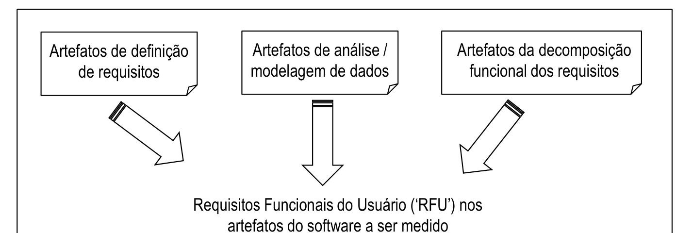
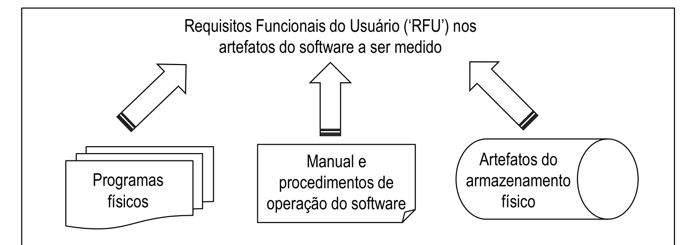
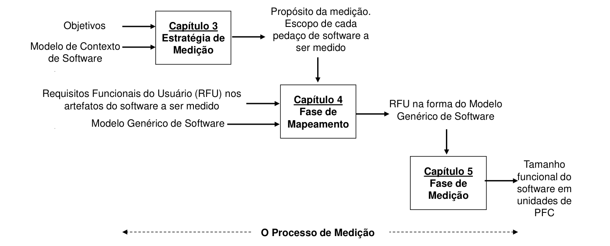

# 1 Introdução

> Método COSMIC v3.0.1 — Manual de Medição

## 1.1 Aplicabilidade do Método COSMIC

### 1.1.1 Domínios aplicáveis

O método COSMIC para medição de tamanho funcional foi projetado para ser aplicável à funcionalidade de software dos seguintes domínios:

- Software aplicativo de negócio normalmente necessário para apoiar a administração de negócios tais como: bancos, seguros, contabilidade, pessoal, compras, distribuição ou manufatura. Tal tipo de software é muitas vezes caracterizado como 'rico em dados', pois é amplamente dominado pela necessidade de gerenciar uma grande quantidade de dados sobre eventos do mundo real.
- Software de tempo-real, com a finalidade de acompanhar ou controlar eventos acontecendo no mundo real. Exemplos seriam: software para ligações telefônicas e troca de mensagens, software embarcado em dispositivos para controlar máquinas tais como eletrodomésticos, elevadores, motores de automóveis e aeronaves, controle de processos e aquisição automática de dados, assim como software contido no sistema operacional de computadores.
- Híbridos dos tipos de software acima, tais como sistemas em tempo-real para reservas de companhias aéreas e hotéis, por exemplo.

### 1.1.2 Domínio não-aplicável

O método de medição COSMIC ainda não foi projetado para levar em conta a funcionalidade de software intensivo em matemática, isto é, software caracterizado por algoritmos matemáticos complexos, ou outras regras especializadas e complexas, tais como sistemas especialistas, software para simulação, software para auto-aprendizagem, sistemas para predição do tempo, etc., ou que processe variáveis contínuas, tais como sons de áudio ou imagens de vídeo, por exemplo: software para jogos de computador, instrumentos musicais, etc.

No caso de software com tal funcionalidade é possível, no entanto, definir extensões locais ao método de medição COSMIC. O Manual de Medição explica em quais contextos tais extensões locais deveriam ser usadas e fornece exemplos de uma extensão local. Quando utilizadas, tais extensões devem ser reportadas de acordo com as convenções apresentadas no capítulo sobre reporte das medições deste Manual de Medição.

### 1.1.3 Limitações nos fatores que contribuem para o tamanho funcional

Além do que já foi dito, o método COSMIC para medição do tamanho funcional não tenta medir todos os aspectos possíveis da funcionalidade que poderiam ser considerados com contribuintes do 'tamanho' do software. Por exemplo, nem a influência da 'complexidade' (seja lá como for definida) sobre o tamanho do software, nem a influência do número de atributos de dados por movimentação de dados são capturados por este método de medição (para saber mais sobre isto, consultar o capítulo Fase de Mapeamento deste manual). Conforme descrito na seção 1.1.2, se desejado, tais aspectos do tamanho funcional podem ser considerados em uma extensão local do método COSMIC para medição.

### 1.1.4 Limitação na medição de pedaços de software muito pequenos

Todos os métodos para a medição funcional de tamanho são baseados nas suposições de um modelo simplificado da funcionalidade do software, que pretende ser razoável 'na média' para o seu domínio de aplicabilidade. Dessa forma, é necessário cuidado ao medir, comparar ou utilizar (por exemplo, em estimativas) tamanhos de pedaços de software muito pequenos, especialmente de alterações muito pequenas em um pedaço de software, quando as suposições 'médias' podem não ser válidas. No caso do método COSMIC, 'muito pequenas' significa 'poucas movimentações de dados'.

## 1.2 Requisitos Funcionais do Usuário

O método de medição COSMIC envolve a aplicação de um conjunto de modelos, princípios, regras e processos aos Requisitos Funcionais do Usuário (ou 'RFU') de um dado pedaço de software. O resultado é um número, o 'valor de uma quantidade' (conforme definido pela ISO), representando o tamanho funcional do pedaço de software de acordo com o método COSMIC.

Os tamanhos funcionais medidos pelo método COSMIC são projetados para serem independentes de quaisquer decisões sobre implementação contidas nos artefatos operacionais do software a ser medido. A 'funcionalidade' refere-se ao 'processamento da informação que o software deve realizar para seus usuários'.

Mais especificamente, uma declaração de RFU descreve 'o quê' o software deve fazer para os usuários funcionais que são a fonte e o destino pretendido para os dados, de e para o software. Uma declaração de RFU exclui quaisquer requisitos técnicos ou de qualidade que dizem 'como' o software deve executar. (Ver seção 2.2 para a definição formal de RFU) Somente os RFU são levados em conta na medição do tamanho funcional.

### 1.2.1 Extraindo os requisitos funcionais do usuário dos artefatos de software, na prática

No mundo real do desenvolvimento de software é raro encontrar artefatos de software nos quais os RFU estejam claramente separados dos outros tipos de requisitos e expressos de uma forma adequada para a medição direta sem qualquer tipo de interpretação. Isto significa que geralmente o medidor terá que extrair os RFU conforme fornecidos, ou subentendidos nos artefatos reais do software, antes de mapeá-los para os conceitos dos 'modelos de software' COSMIC.

*Figura 1.2.1 – Modelo COSMIC dos requisitos funcionais do usuário pré-implementação*

Conforme ilustrado na figura 1.2.1, os RFU podem ser derivados dos artefatos de engenharia de software produzidos antes que o software exista. Assim sendo, o tamanho funcional do software pode ser medido antes de sua implementação em um sistema de computador.

É importante notar que os artefatos produzidos antes da implementação do software, por exemplo, durante o levantamento ou análise dos requisitos, podem descrever o software a diferentes 'níveis de granularidade', conforme evoluírem os requisitos – ver a seção 2.4 adiante.

Nota: Os requisitos funcionais do usuário podem ser produzidos antes de serem alocados ao hardware ou software. Como o método COSMIC tem como alvo o dimensionamento dos RFU de um pedaço de software, apenas os RFU alocados ao software são medidos. Entretanto, por princípio, o COSMIC pode ser aplicado aos RFU antes que estejam alocados ao hardware ou software, independentemente da decisão final sobre a alocação. Por exemplo, é direto o dimensionamento da funcionalidade de uma calculadora de bolso utilizando COSMIC, sem qualquer conhecimento de qual hardware ou software (se algum) estará envolvido. Contudo, a afirmação de que o método COSMIC pode ser utilizado para dimensionar RFU alocados a hardware precisa de mais testes na prática, antes de ser considerada totalmente validada sem a necessidade de regras adicionais.

### 1.2.2 Derivando os requisitos funcionais do usuário a partir de software instalado

Às vezes poderá ser necessário medir algum pedaço de software existente sem que estejam disponíveis artefatos de design ou arquitetura em quantidade suficiente, com os RFU não documentados (por exemplo, no caso de software legado). Nesses casos, ainda será possível derivar os RFU a partir dos artefatos instalados no sistema computacional mesmo após a implementação, conforme ilustrado na figura 1.2.2.

*Figura 1.2.2 – Modelo COSMIC dos requisitos funcionais do usuário pós-implementação*

### 1.2.3 Extraindo ou derivando os requisitos funcionais do usuário dos artefatos de software

O processo a ser utilizado e daí o esforço requerido para extrair os RFU dos diferentes tipos de artefatos de engenharia de software, ou derivá-los a partir de software instalado, expressando-os na forma requerida para medição pelo método COSMIC obviamente irão variar; tais processos não podem ser tratados no Manual de Medição. É feita a suposição de que os requisitos funcionais do usuário do software a ser medido existam, ou que possam ser extraídos ou derivados de seus artefatos, à luz do propósito da medição.

O Manual de Medição limita-se então a descrever e definir os conceitos dos modelos de software COSMIC, isto é, os objetivos para a extração ou derivação.[^3] Tais conceitos encontram-se em um conjunto de princípios estabelecidos em dois modelos de software COSMIC – o 'Modelo de Contexto de Software' e o 'Modelo Genérico de Software'.

Esses dois modelos são descritos no documento 'Visão Geral do Método'. Os leitores que precisem de um entendimento genérico e de justificativa para os modelos são remetidos àquele documento. Os modelos são copiados abaixo para facilitar e detalhados nos Capítulos 2 e 3 deste Manual de Medição, respectivamente.

## 1.3 O Modelo de Contexto de Software COSMIC

Um pedaço de software a ser medido com o método COSMIC deve ser cuidadosamente definido (no escopo da medição) e tal definição deve levar em conta, em seu contexto, qualquer outro software e/ou hardware com o qual o mesmo interaja. Este Modelo de Contexto de Software apresenta os princípios e conceitos necessários a esta definição.

Nota – Os termos em negrito na primeira vez que aparecem nas seções 1.3 e 1.4 a seguir possuem significados que podem ser específicos do método COSMIC. Para obter as respectivas definições formais, ver o glossário no documento 'Visão Geral da Documentação e Glossário de Termos'. Todos esses termos são explicados em maior detalhe nos capítulos 2, 3 e 4 a seguir.

> **PRINCÍPIOS – O Modelo de Contexto de Software COSMIC**
>
> a) O Software é delimitado pelo hardware
>
> b) O software é normalmente estruturado em **camadas**
>
> c) Uma camada pode conter um ou mais pedaços de software '**pares**' distintos e qualquer pedaço de software pode ser composto de componentes pares distintos
>
> d) Qualquer pedaço de software a ser medido deverá ser definido por seu **escopo** de medição, o qual deve estar integralmente contido em uma única camada
>
> e) O escopo de um pedaço de software a ser medido depende do **propósito** da medição
>
> f) Os **usuários funcionais** de um pedaço de software devem ser identificados a partir dos requisitos funcionais do usuário do pedaço de software a ser medido, como fontes e/ou destinos pretendidos para os dados
>
> g) Um pedaço de software interage com os seus usuários funcionais por meio de **movimentações de dados** através de uma **fronteira**, e o pedaço de software pode mover dados de e para o **armazenamento persistente** dentro da fronteira
>
> h) Os RFU do software podem ser expressos a diferentes **níveis de granularidade**
>
> i) O nível de granularidade no qual as medições devem ser normalmente efetuadas é o dos **processos funcionais**
>
> j) Se não for possível medir no nível de granularidade dos processos funcionais, nesse caso os RFU do software devem ser medidos através de uma abordagem de aproximação e escalonados para o nível de granularidade dos processos funcionais[^4]

Os conceitos do Modelo de Contexto de Software são detalhados no Capítulo 2, 'Estratégia de Medição', deste Manual de Medição.

## 1.4 O Modelo Genérico de Software

Uma vez interpretados os RFU do software a ser medido em termos do Modelo de Contexto de Software, aplicamos o Modelo Genérico de Software aos RFU, para identificar os componentes da funcionalidade que serão medidos. Este Modelo Genérico de Software assume que os seguintes princípios gerais são verdadeiros para qualquer software que possa ser medido com o método: (conforme consta do glossário, qualquer método de medição funcional tem como objetivo identificar 'tipos' e não 'ocorrências' de dados ou funções. No texto abaixo, o termo 'tipo' será omitido ao mencionar os conceitos básicos do COSMIC, a não ser que isso seja essencial para distinguir 'tipos' de ocorrências.)

> **PRINCÍPIOS – O Modelo Genérico de Software COSMIC**
>
> a) O software recebe dados de **entrada** dos seus usuários funcionais, gerando **saídas** e/ou outros resultados para os usuários funcionais
>
> b) Os requisitos dos usuários funcionais de um pedaço de software a ser medido podem ser mapeados para processos funcionais distintos
>
> c) Cada processo funcional consiste de **subprocessos**
>
> d) Um subprocesso pode ser uma movimentação de dados ou uma **manipulação de dados**
>
> e) Cada processo funcional é disparado por um movimento de dados do tipo **Entry** proveniente de um usuário funcional, o qual informa ao processo funcional que o usuário funcional identificou um **evento**
>
> f) Uma movimentação de dados movimenta um único **grupo de dados**
>
> g) Um grupo de dados consiste de um único conjunto de **atributos de dados** que descreve um único objeto de interesse
>
> h) Há quatro tipos de movimentação de dados. Uma **Entry** movimenta um grupo de dados para dentro do software, a partir de um usuário funcional. Uma **Exit** movimenta um grupo de dados para fora do software, em direção a um usuário funcional. Um **Write** movimenta um grupo de dados do software para o armazenamento persistente. Um **Read** movimenta um grupo de dados do armazenamento persistente para o software
>
> i) Um processo funcional deve incluir pelo menos uma movimentação de dados Entry e uma movimentação de dados Write ou Exit, ou seja, deve incluir no mínimo duas movimentações de dados
>
> j) Como uma aproximação para fins de medição, os subprocessos de manipulação de dados não são medidos separadamente; assume-se que a funcionalidade de qualquer manipulação de dados será considerada na movimentação de dados com a qual a mesma esteja associada

Os conceitos do Modelo Genérico de Software são detalhados no Capítulo 3 – 'Fase de Mapeamento' deste Manual de Medição.

Quando os RFU a serem medidos tiverem sido mapeados para o Modelo Genérico de Software, os mesmos poderão ser medidos utilizando-se o processo da Fase de Medição (Capítulo 4). Os resultados da medição devem ser reportados de acordo com as convenções de 'Reportando a Medição' (Capítulo 5).

## 1.5 O Processo de Medição COSMIC

O processo geral de medição COSMIC consiste de três fases:

- a Estratégia de Medição, na qual o Modelo de Contexto de Software é aplicado ao software a ser medido (Capítulo 2)
- a Fase de Mapeamento, na qual o Modelo Genérico de Software é aplicado ao software a ser medido (Capítulo 3)
- a Fase de Medição, na qual as medições de tamanho propriamente ditas são obtidas (Capítulo 4)

O resultado da aplicação do processo de medição a um pedaço de software é uma medida de tamanho funcional dos Requisitos Funcionais do Usuário do pedaço de software expressa em 'Pontos de Função COSMIC' (ou 'PFC').

A relação entre essas três fases do método COSMIC é apresentada na Fig. 1.5.

*Figura 1.5 – Estrutura do método COSMIC*

[^3]: O 'Guia para Dimensionamento de Software Aplicativo de Negócios utilizando COSMIC' fornece orientações para o mapeamento de vários métodos de análise de dados e determinação de requisitos utilizados no domínio da aplicação de negócio para os conceitos COSMIC.

[^4]: Os assuntos 'dimensionamento aproximado' (i.e., estimar um tamanho quando não estiverem disponíveis todos os detalhes necessários à medição de um tamanho exato) e o escalonamento entre diferentes níveis de granularidade são tratados no documento do método COSMIC 'Tópicos Avançados e Relacionados'.
