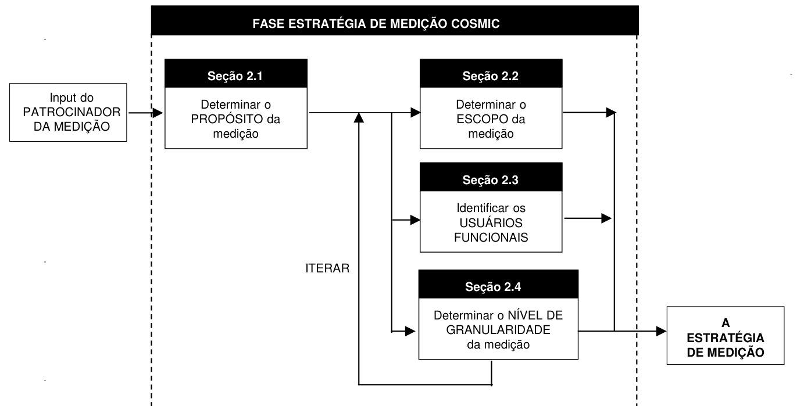
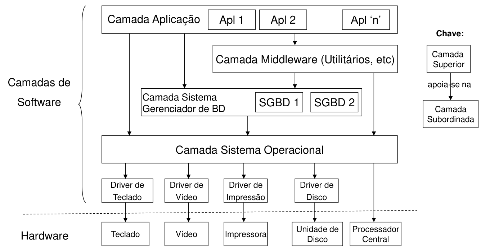
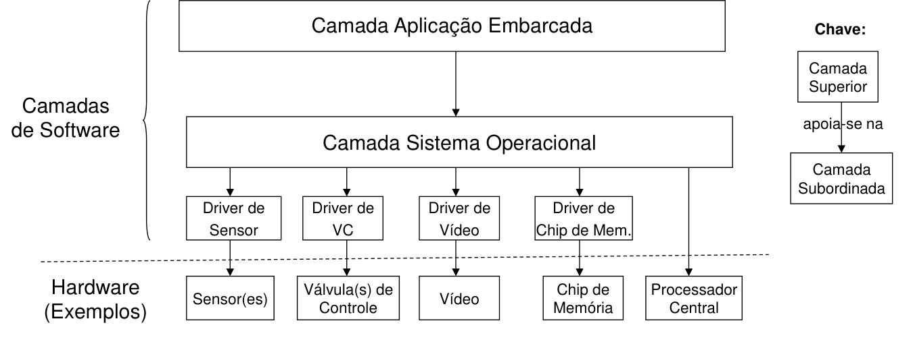
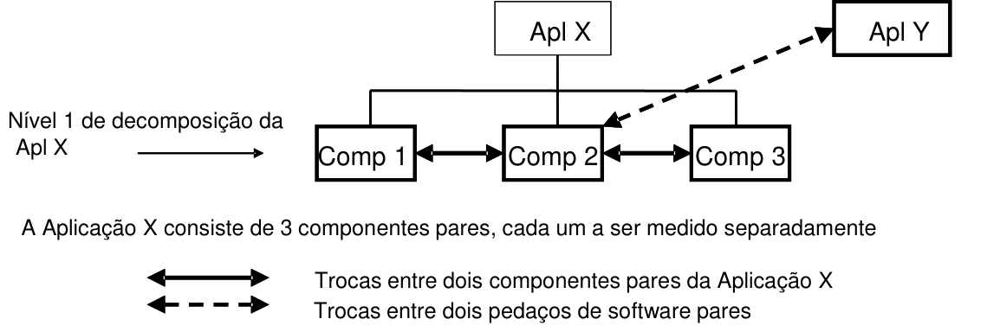
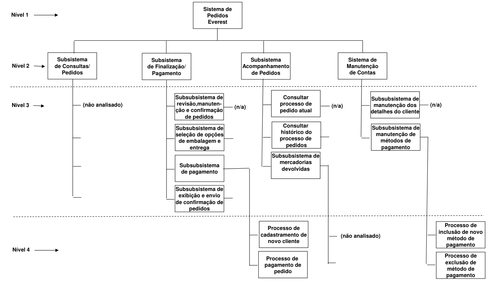

# 2 A Fase Estratégia de Medição

> Método COSMIC v3.0.1 — Manual de Medição

Este capítulo aborda os quatro parâmetros-chave da medição de tamanho funcional de software que devem ser considerados antes de iniciar a medição, a saber: o propósito e o escopo da medição, a identificação dos usuários funcionais e o nível de granularidade que deve ser medido. A determinação desses parâmetros ajuda a responder perguntas tais como 'qual tamanho deve ser medido?' ou, para uma medição existente, 'como devemos interpretar esta medição?'

É importante notar que esses quatro parâmetros e os conceitos relacionados não são específicos do método de medição de tamanho funcional (MTF) COSMIC, mas devem ser comuns a todos os métodos MTF. Outros métodos MTF podem não distinguir os diferentes tipos de usuários funcionais, não discutir diferentes níveis de granularidade, etc. É somente a aplicabilidade mais ampla e a flexibilidade do método COSMIC que requerem a consideração desses parâmetros de uma maneira mais cuidadosa do que aquela utilizada por outros métodos MTF.

É muito importante incluir os dados originados nesta fase Estratégia de Medição (conforme seção 5.2) ao registrar o resultado de qualquer medição. A falta da definição e registro consistente destes parâmetros levará a medições que não poderão ser interpretadas de forma confiável, comparadas, ou utilizadas como entrada para processos tais como a estimativa do esforço do projeto.

As quatro seções deste capítulo fornecem as definições formais, princípios e regras, assim como alguns exemplos de cada um dos parâmetros-chave, para ajudar o medidor no processo de determinação de uma Estratégia de Medição, conforme mostrado na figura 2.0 abaixo.

Cada seção fornece uma explicação contextual sobre a razão da importância do parâmetro, utilizando analogias para mostrar por que o parâmetro é comum em outros campos da medição e, dessa forma, mostrar que também deve ser considerado no campo de medição de tamanho funcional de software.

*Figura 2.0 - O processo de determinação de uma Estratégia de Medição*

## 2.1 Definindo o propósito da medição

O termo propósito é utilizado com o seu significado normal no idioma.

> **DEFINIÇÃO – Propósito de uma medição**
>
> Uma afirmação que define por que uma medição é requerida e para quê o resultado será utilizado.

### 2.1.1 O propósito da medição – uma analogia

Há muitas razões para medir o tamanho funcional do software, assim como há muitas razões para medir, por exemplo, as áreas das superfícies de uma casa. Quando o propósito é estimar o custo de um novo desenvolvimento de software, pode ser necessário medir o tamanho funcional do software antes do seu desenvolvimento, assim como pode ser necessário medir as áreas das superfícies de uma casa antes de sua construção. Em um contexto diferente, por exemplo, na comparação de custos reais com estimados, pode ser necessário medir o tamanho funcional do software no momento de sua entrada em produção, da mesma forma que poderia ser útil medir as áreas das superfícies de uma casa depois de construída, para verificar se as dimensões reais estão de acordo com os respectivos planos. O motivo pelo qual uma medida é realizada tem um impacto, embora muitas vezes sutil, *naquilo* que é medido, *sem afetar* a unidade de medida ou os princípios de medição.

No exemplo da casa acima, a medição das áreas de suas superfícies antes da construção baseia-se, obviamente, nos planos de construção. As dimensões requeridas (comprimento e largura) são extraídas dos planos utilizando-se convenções de escalonamento apropriadas, assim como as áreas das superfícies são calculadas de acordo com convenções bem estabelecidas.

Analogamente, a medição do tamanho funcional do software antes do seu desenvolvimento baseia-se nos requisitos funcionais do usuário derivados de seus 'planos', isto é, nos artefatos de software produzidos antes do desenvolvimento. Os requisitos funcionais do usuário são derivados desses artefatos, utilizando-se convenções apropriadas, assim como é identificado o número de dimensões requerido (o número de movimentações de dados), de modo que o tamanho possa ser calculado.

Para prosseguir na analogia da casa, a medição das áreas de suas superfícies após a construção implica em um processo algo diferente. Neste ponto, as dimensões requeridas (comprimento e largura) são extraídas da própria construção, utilizando-se uma ferramenta diferente (fita métrica). No entanto, embora o objeto medido seja diferente (a casa ao invés dos planos), as dimensões, a unidade de medida (incluindo quaisquer convenções de escalonamento) e os princípios de medição permanecem constantes.

Da mesma forma, a medição do tamanho funcional do software depois de colocado em produção implica em um processo de medição um pouco diferente, no qual as dimensões requeridas são extraídas dos vários artefatos do próprio software. Embora a natureza desses artefatos seja diferente, as dimensões, a unidade de medida e os princípios de medição permanecem os mesmos.

Cabe ao medidor, com base no propósito da medição, determinar se o objeto a ser medido é a casa conforme verbalmente descrita por seu proprietário, conforme descrita nos planos, ou a casa construída, e selecionar os artefatos mais apropriados à medição. É claro que os três tamanhos podem ser diferentes. O mesmo raciocínio aplica-se à medição de software.

EXEMPLOS: A seguir, alguns propósitos típicos da medição

- Medir o tamanho dos RFU ao longo de sua evolução, como entrada para um processo de estimativa do esforço de desenvolvimento
- Medir o tamanho das mudanças nos RFU depois que os mesmos foram inicialmente acordados, a fim de gerenciar a variação não controlada no escopo do projeto ('scope creep')
- Medir o tamanho dos RFU do software entregue, como entrada para a medição do desempenho do desenvolvedor
- Medir o tamanho dos RFU do software total <u>entregue</u>, bem como o tamanho dos RFU do software <u>desenvolvido</u>, a fim de obter uma medida de reuso funcional
- Medir o tamanho dos RFU do software existente, como entrada para a medição do desempenho daqueles responsáveis por manter e suportar o software
- Medir o tamanho de algumas mudanças em um sistema de software existente (ou nos respectivos RFU), como uma medida do tamanho do resultado do trabalho de uma equipe de projeto de melhoria
- Medir o tamanho da funcionalidade do software existente fornecida aos usuários funcionais humanos

### 2.1.2 A importância do propósito

O propósito ajuda o medidor a determinar:

- o escopo a ser medido e, dessa forma, os artefatos que serão necessários para a medição
- os usuários funcionais (conforme será mostrado na seção 2.3, o tamanho funcional muda dependendo de quem ou o quê é definido como o usuário funcional)
- o ponto no tempo, no ciclo de vida do projeto, no qual a medição acontecerá
- a exatidão requerida para a medição, e daí se o método de medição COSMIC deverá ser usado, ou uma versão aproximada e localmente derivada do método (por exemplo, no início do ciclo de vida de um projeto, antes que os RFU estejam completamente detalhados). Estes dois últimos pontos determinarão o nível de granularidade no qual os RFU serão medidos.

## 2.2 Definindo o escopo da medição

> **DEFINIÇÃO – Escopo de uma medição**
>
> O conjunto de Requisitos Funcionais do Usuário a serem incluídos em um exercício específico de medição funcional de tamanho.
>
> NOTA: Uma distinção deve ser feita entre o 'escopo total', isto é, todo o software que deveria ser medido de acordo com o propósito, e o 'escopo' de qualquer pedaço individual de software dentro do escopo total, cujo tamanho deva ser medido separadamente. Neste Manual de Medição, o termo 'escopo' (ou a expressão 'escopo da medição') relaciona-se a um pedaço individual de software cujo tamanho deve ser medido separadamente.

Os Requisitos Funcionais do Usuário são definidos pela ISO como segue:

> **DEFINIÇÃO – Requisitos Funcionais do Usuário (RFU)**
>
> Um subconjunto dos Requisitos do Usuário. Requisitos que descrevem o que o software deve fazer, em termos de tarefas e serviços.
>
> NOTA: Os Requisitos Funcionais do Usuário dizem respeito, mas não estão limitados a:
>
> - transferência de dados (p.ex., Entrar com dados do cliente; Enviar sinal de controle)
> - transformação de dados (p.ex., Calcular juros bancários; Derivar temperatura média)
> - armazenamento de dados (p.ex., Armazenar pedido do cliente; Registrar temperatura ambiente ao longo do tempo)
> - recuperação de dados (p.ex., Listar empregados atuais; Recuperar posição mais recente da aeronave)
>
> Exemplos de Requisitos do Usuário que não são Requisitos Funcionais do Usuário incluem, mas não estão limitados a:
>
> - restrições de qualidade (p.ex., usabilidade, confiabilidade, eficiência e portabilidade)
> - restrições organizacionais (p.ex., locais de operação, hardware-alvo e conformidade com padrões)
> - restrições ambientais (p.ex., interoperabilidade, segurança e privacidade)
> - restrições de implementação (p.ex., linguagem de desenvolvimento, prazo de entrega)

> **REGRAS – Escopo**
>
> a) O escopo de uma Medição de Tamanho Funcional (MTF) deve ser derivado do propósito da medição.
>
> b) O escopo de uma medição qualquer não deve contemplar mais do que uma camada do software a ser medido

### 2.2.1 Derivando o escopo a partir do propósito de uma medição

É importante definir o escopo de uma medição antes de iniciar um exercício de medição específico.

Prosseguindo com a analogia de construção de uma casa, se o propósito for a estimativa de custos pode ser necessário medir o tamanho de diversas partes da casa separadamente, por exemplo, fundações, paredes e telhado, já que as mesmas utilizam diferentes métodos de construção. O mesmo é verdade para a estimativa dos custos de desenvolvimento de software.

Se um sistema de software a ser desenvolvido consiste de pedaços que residirão em diferentes camadas da arquitetura do sistema, então o tamanho do software em cada camada deverá ser medido separadamente, i.e., cada pedaço possuirá um escopo separado definido para fins de medição do tamanho. Isto vem do princípio (d) do Modelo de Contexto de Software. (para mais sobre camadas, ver seção 2.2.4 abaixo.)

Similarmente, se o software tiver que ser desenvolvido como um conjunto de componentes pares dentro de uma única camada, cada um utilizando tecnologias diferentes, então será necessário definir um escopo de medição separado para cada componente antes de medir seus tamanhos.

EXEMPLO 1: Se cada componente do software utilizar uma tecnologia diferente e as medições forem utilizadas para estimar o esforço de desenvolvimento, então um escopo de medição separado deverá ser definido para cada componente, pois cada medição de tamanho será associada a uma produtividade de desenvolvimento diferente. (Para saber mais sobre componentes pares, ver seção 2.2.5 adiante)

O propósito também ajuda a determinar o software a ser incluído/excluído do escopo da medição.

EXEMPLO 2: Se o propósito for medir o tamanho funcional de todo o software entregue por uma equipe específica de um projeto, primeiro será necessário definir os requisitos funcionais do usuário de todos os pedaços e componentes entregues pela equipe. Estes poderão incluir os RFU de um pedaço de software que foi utilizado apenas uma vez para converter dados do software que está sendo substituído.

EXEMPLO 3: Se o propósito for medir o tamanho do novo software que está disponível para utilização operacional, este será menor do que o do Exemplo 2, já que os RFU do software utilizado para conversão não serão incluídos no escopo do tamanho medido.

Em resumo, o propósito da medição sempre precisa ser usado para determinar (1) qual software deve ser incluído/ excluído do escopo total e (b) a maneira como o software incluído pode precisar ser dividido em pedaços distintos, cada qual com seu escopo, para que possam ser medidos separadamente.

### 2.2.2 Tipos genéricos de escopo

EXEMPLOS

- Uma carteira corporativa
- Uma declaração de requisitos contratualmente acordada
- O produto do trabalho entregue por uma equipe de projeto (i.e., incluindo o que foi obtido através da exploração dos parâmetros de software existente, pacotes comprados e código reutilizável, qualquer software utilizado para conversão de dados e em seguida descartado, assim como utilitários e software de teste desenvolvido especificamente para este projeto)
- O produto do trabalho desenvolvido por uma equipe de projeto (i.e., incluindo qualquer software desenvolvido pela equipe e utilizado para conversão de dados e em seguida descartado, assim como quaisquer utilitários e software de teste desenvolvido especificamente para este projeto, porém excluindo toda a funcionalidade obtida pela alteração de parâmetros, exploração de código reutilizável, ou pacotes comprados
- Todo o software em uma camada
- Um pacote de software
- Um aplicativo
- Um componente principal ('par') de um aplicativo
- Uma classe de objetos reutilizável
- Todas as mudanças requeridas para uma nova 'release' de um pedaço de software existente

Na prática, uma declaração de escopo precisa ser explícita ao invés de genérica, i.e., o produto do trabalho desenvolvido pela equipe de projeto 'A', ou aplicativo 'B', ou a carteira da corporação 'C'. A declaração de escopo pode, para fins de clareza, precisar dizer o que foi excluído.

### 2.2.3 Níveis de decomposição

Notar que alguns dos 'tipos de escopo genéricos' listados acima correspondem a diferentes 'níveis de decomposição' do software, definidos como segue:

> **DEFINIÇÃO – Nível de decomposição**
>
> Qualquer nível resultante da divisão de um pedaço de software em componentes (denominados 'Nível 1', por exemplo), seguida pela divisão dos componentes em subcomponentes ('Nível 2'), então pela divisão dos subcomponentes em subsubcomponentes ('Nível 3'), etc.
>
> NOTA 1: Não deve ser confundido com 'nível de granularidade'.
>
> NOTA 2: As medições de tamanho dos componentes de um pedaço de software podem ser diretamente comparáveis apenas no caso de componentes pares, isto é, componentes no mesmo nível de decomposição.

EXEMPLO: Diferentes níveis de decomposição, correspondentes a diferentes 'tipos genéricos de escopo' ocorrem quando uma 'carteira de aplicativos' consiste de diversos 'aplicativos', cada um dos quais pode ser composto de 'componentes principais (pares)', cada um dos quais pode por sua vez consistir de 'classes de objetos reutilizáveis'.

A determinação de um escopo de medição pode assim ser mais do que apenas uma questão de decidir quais funcionalidades devem ser incluídas na medição. A decisão também pode envolver a consideração do nível de decomposição de software no qual as medições serão feitas. Esta é uma importante decisão da Estratégia de Medição, dependente do propósito da medição, já que medições em diferentes níveis de decomposição não podem ser facilmente comparadas. Isto ocorre porque, conforme será visto na seção 4.3.1 regra (g), o tamanho de um pedaço de software não pode ser obtido pela simples soma dos tamanhos de seus componentes.

### 2.2.4 Camadas

Como o escopo de um pedaço de software a ser medido deve ser limitado a uma única camada de software, o processo de definição do escopo pode exigir que o medidor decida primeiro quais são as camadas da arquitetura de software. Nesta seção vamos definir e discutir 'camadas' de software, da forma que esse termo é utilizado no método COSMIC.

As razões para essas definições e regras são apresentadas a seguir:

- O medidor pode estar diante da medição de algum software em um ambiente de software 'legado', o qual evoluiu durante muitos anos sem nunca ter sido projetado em conformidade com uma arquitetura subjacente (trata-se da chamada 'arquitetura espaguete'). O medidor precisará então de orientações sobre como distinguir as camadas de acordo com a terminologia COSMIC
- As expressões 'camada', 'arquitetura em camadas' e 'componente par' não são utilizadas consistentemente na indústria de software. Se o medidor precisar medir algum software descrito como construído segundo uma 'arquitetura em camadas', é aconselhável verificar se as 'camadas' nessa arquitetura estão definidas de uma maneira compatível com o método COSMIC. Para isso, o medidor deverá estabelecer a equivalência entre os objetos arquiteturais específicos do paradigma da 'arquitetura em camadas' e o conceito de camadas definido neste manual

As camadas podem ser identificadas de acordo com as seguintes definições e princípios:

> **DEFINIÇÃO – Camada**
>
> Uma camada é uma partição resultante da divisão funcional de um sistema de software que, juntamente com o hardware, forma um sistema computacional completo, onde:
>
> - as camadas são organizadas segundo uma hierarquia
> - há apenas uma camada em cada nível da hierarquia
> - há uma dependência hierárquica do tipo 'superior/subordinado' entre os serviços funcionais providos pelo software em quaisquer duas camadas da arquitetura de software que troquem dados diretamente
> - os softwares em quaisquer duas camadas da arquitetura de software que troquem dados interpretam apenas parte daqueles dados identicamente

A identificação de camadas é um processo iterativo. As camadas exatas serão refinadas conforme o processo de mapeamento progredir. Uma vez identificada, cada camada candidata deve se conformar aos seguintes princípios e regras:

> **PRINCÍPIOS – Camada**
>
> a) O software em uma camada troca dados com o software em outra camada através dos seus respectivos processos funcionais.
>
> b) A 'dependência hierárquica' entre camadas é tal que o software em qualquer camada pode utilizar os serviços funcionais de qualquer software em qualquer camada abaixo dele na hierarquia. Onde há tais relações de uso, denominamos a camada que utiliza o software abaixo como 'superior' e qualquer camada contendo software utilizado como sua 'subordinada'. O software na camada superior apoia-se nos serviços de software dessas camadas subordinadas para rodar adequadamente; estas últimas apoiam-se por sua vez em suas camadas subordinadas para rodar adequadamente, e assim em toda a hierarquia. Por outro lado, o software em uma camada subordinada, juntamente com o software em quaisquer camadas subordinadas da qual ele depende, pode rodar sem precisar dos serviços de nenhuma camada superior na hierarquia.
>
> c) O software em uma camada não utiliza, necessariamente, todos os serviços funcionais providos pelo software em uma camada subordinada.
>
> d) Os dados que são trocados entre pedaços de software em quaisquer duas camadas são definidos e interpretados diferentemente nos respectivos RFU dos dois pedaços de software, isto é, os dois pedaços de software reconhecem diferentes atributos de dados e/ou subgrupos de dados sendo trocados. Contudo, devem existir também um ou mais atributos de dados ou subgrupos definidos em comum, para permitir que o software na camada recebedora interprete os dados passados pelo software na camada remetente, de acordo com as necessidades do software recebedor.

> **Regras – Camada**
>
> a) Se o software for concebido utilizando-se uma arquitetura de camadas estabelecida de acordo com o modelo COSMIC, então aquela arquitetura deverá ser utilizada para identificar as camadas para fins de medição
>
> b) No domínio de MIS ou software de negócio, a camada 'topo', i.e., a camada que não é subordinada a nenhuma outra camada, é normalmente referenciada como a camada 'da aplicação'. O software (aplicativo) desta camada apoia-se, em última instância, nos serviços providos pelos softwares de todas as outras camadas para poder executar adequadamente. No domínio de software 'real-time', o software da 'camada topo' é comumente referenciado como sendo um 'sistema', por exemplo, 'sistema de controle de processo', 'sistema de controle de vôo', etc.
>
> c) Não assumir que qualquer software que tenha evoluído sem a consideração de um projeto arquitetural ou estruturação possa ser dividido em camadas de acordo com o modelo COSMIC.

Pacotes de software de serviços funcionais tais como sistemas de gerenciamento de banco de dados, sistemas operacionais ou direcionadores de dispositivos devem ser normalmente considerados como localizados em camadas distintas.

Uma vez identificada, cada camada pode ser registrada como um 'componente' distinto na matriz do Modelo Genérico de Software (apêndice A), com o rótulo correspondente.

EXEMPLO 1: A estrutura física típica de uma arquitetura de software em camadas (utilizando o termo 'camada' conforme definido aqui) é fornecida na figura 2.2.4.1:

*Figura 2.2.4.1 – Arquitetura de software típica em camadas, para um sistema de Negócios/MIS*

EXEMPLO 2: A estrutura física típica de uma arquitetura de software em camadas (novamente utilizando o termo 'camada' conforme definido aqui) suportando um pedaço de software 'real-time' embarcado é fornecida na figura 2.2.4.2:

*Figura 2.2.4.2 – Arquitetura típica em camadas para um sistema de software 'real-time' embarcado*

### 2.2.5 Componentes pares

Dado o conceito de camadas, 'par' é definido como segue:

> **DEFINIÇÃO – Par**
>
> Dois pedaços de software são pares um do outro se ambos residirem na mesma camada.
>
> NOTA. Dois pedaços pares de software não precisam estar no mesmo nível de decomposição.

Componentes pares podem ser identificados de acordo com a seguinte definição e princípios.

> **DEFINIÇÃO – Componente Par**
>
> Um componente de um conjunto de componentes cooperando, todos ao mesmo nível de decomposição, que resulta de se dividir um pedaço de software dentro de uma camada, onde cada componente atende uma porção dos Requisitos Funcionais do Usuário daquele pedaço de software.
>
> NOTA: A divisão de um pedaço de software em componentes pares pode ser efetuada em resposta aos requisitos funcionais e não-funcionais do usuário.

Uma vez identificado, cada componente par candidato precisa conformar-se aos seguintes princípios:

> **PRINCÍPIOS – Componente Par**
>
> a) Em um conjunto de componentes pares de um pedaço de software em uma camada não há dependência hierárquica entre os componentes pares da forma que há entre camadas. Os RFU de todos os componentes pares de um pedaço de software em uma camada estão no mesmo 'nível' na hierarquia de camadas.
>
> b) Todos os componentes pares de um pedaço de software devem cooperar para que o pedaço de software execute com sucesso.
>
> c) Um grupo de dados pode ser diretamente trocado entre dois componentes pares de um pedaço de software, por um processo funcional de um primeiro componente emitindo uma Exit recebida como uma Entry por um processo funcional do segundo componente. Alternativamente, a troca pode acontecer de forma indireta, com um processo funcional de um primeiro componente tornando um grupo de dados persistente através de um Write, que pode ser recuperado em seguida por um Read de um processo funcional do segundo componente.

Uma vez identificado, cada componente par pode ser registrado como um componente distinto na matriz do Modelo Genérico de Software (apêndice A), com o rótulo correspondente.

EXEMPLO: Quando um aplicativo de negócio é desenvolvido com três componentes principais, especificamente um componente 'interface com o usuário' (ou 'front-end'), um componente de 'regras de negócio' e um componente de 'serviços de dados', os três componentes são componentes pares.

Nota: Dois componentes pares distintos que existem na mesma camada e trocam dados entre si podem fazer isso por meio de uma das sequências alternativas definidas no Princípio (c) para dois componentes pares.

O diagrama seguinte mostra uma situação que ilustra o Exemplo. Todo o software mostrado reside na mesma camada da aplicação. As trocas entre os dois componentes pares da Aplicação X e entre os dois pedaços de software pares (Componente 2 da Aplicação X e Aplicação Y) podem acontecer por meio de uma das sequências alternativas definidas no Princípio (c) para dois componentes pares.

*Figura 2.2.5.1 – Relação entre os conceitos de 'par', 'componente' e 'componente par'*

## 2.3 Identificando os usuários funcionais

### 2.3.1 O tamanho funcional varia com o usuário funcional

Começando com uma analogia, a medição das áreas do chão de um escritório pode ser realizada de acordo com quatro convenções diferentes, como segue. (Nota – o escopo – o escritório específico – é o mesmo para as quatro convenções.)

- O dono do prédio tem que pagar os impostos sobre o escritório. Para o dono do prédio, a área de superfície é a 'metragem quadrada bruta', determinada pelas dimensões externas e dessa forma inclui os saguões públicos, o espaço ocupado pelas paredes, etc.
- O gerente de aquecimento do prédio está interessado na 'metragem quadrada líquida', i.e., as áreas internas, incluindo áreas públicas e o espaço ocupado por elevadores, porém excluindo a espessura das paredes.
- O profissional contratado para a limpeza pelo Inquilino do escritório está interessado na 'metragem líquida-líquida plus', que exclui as áreas públicas, mas inclui corredores utilizados pelo inquilino.
- O gerente de planejamento do escritório está interessado na 'metragem líquida-líquida', i.e., apenas o espaço utilizado para escritórios.

A lição desta analogia é que diferentes tipos de usuários de uma 'coisa' podem 'ver' funcionalidades diferentes e daí medirem tamanhos diferentes para a 'coisa'. No caso do software, diferentes (tipos de) usuários funcionais podem requerer (via seus RFU) e utilizar funcionalidades diferentes; dessa forma, os tamanhos funcionais irão variar com a escolha dos usuários funcionais.

### 2.3.2 Usuários funcionais

Um 'usuário' é definido, de fato[^5], como 'qualquer coisa que interage com o software sendo medido'. Esta definição é ampla demais para as necessidades do método COSMIC. Para o método COSMIC, a escolha do usuário (ou usuários) é determinada pelos requisitos funcionais do 'usuário' a serem medidos. Este (tipo de) usuário, conhecido como 'usuário funcional', é definido a seguir.

> **DEFINIÇÃO – Usuário funcional**
>
> Um (tipo de) usuário que é uma fonte e/ou um destino pretendido para os dados nos Requisitos Funcionais do Usuário de um pedaço de software.

No método COSMIC é essencial distinguir os usuários funcionais de um pedaço de software que deve ser medido de todos os seus possíveis usuários.

EXEMPLO 1: Consideremos uma aplicação de negócio; seus usuários funcionais normalmente incluiriam seres humanos e outras aplicações pares com os quais a aplicação fizesse interface. Para uma aplicação 'real-time', os usuários funcionais normalmente seriam dispositivos de hardware e outros softwares pares de interface. Os requisitos funcionais do usuário (RFU) de tal software são normalmente expressos de forma que os usuários funcionais sejam as fontes de dados e/ou os destinos pretendidos para os dados, de e para o software, respectivamente.

Contudo, o conjunto total de 'usuários', i.e., incluindo 'qualquer coisa' que interaja com o software, deve incluir o sistema operacional. Porém nunca os RFU de nenhuma aplicação incluiriam o sistema operacional como usuário. Quaisquer restrições que o sistema operacional possa impor a uma aplicação serão comuns a todas as aplicações, sendo normalmente tratadas pelo compilador ou interpretador e invisíveis aos verdadeiros usuários funcionais da aplicação. Na medição de tamanho funcional, um sistema operacional nunca seria considerado um usuário funcional de uma aplicação[^6].

Mas nem sempre os usuários funcionais são óbvios.

EXEMPLO 2: Consideremos o software aplicativo de um telefone celular (inicialmente mencionado na Introdução). Embora tenhamos eliminado o sistema operacional do celular como um possível usuário funcional do aplicativo, os 'usuários' ainda poderiam ser (a) seres humanos que pressionam as teclas, ou (b) dispositivos de hardware (p.ex., a tela, teclas, etc.) e aplicações pares que interagem diretamente com o aplicativo do telefone. O usuário humano, por exemplo, verá apenas um subconjunto de toda a funcionalidade que deve ser provida para que o aplicativo do celular funcione. Assim sendo, esses dois tipos de usuários 'verão' funcionalidades diferentes; o tamanho dos RFU para o usuário humano será menor do que os RFU que deverão ser desenvolvidos para fazer funcionar o aplicativo do telefone.[^7]

> **REGRAS – Usuários funcionais**
>
> a) Os usuários funcionais de um pedaço de software a ser medido devem ser derivados do propósito da medição
>
> b) Quando o propósito da medição de um pedaço de software estiver relacionado ao esforço para desenvolver ou modificar o pedaço de software, então os usuários funcionais deverão ser aqueles para quem a funcionalidade nova ou modificada deverá ser fornecida.

Uma vez identificados os usuários funcionais é imediata a identificação da fronteira, já que a mesma situa-se entre o pedaço de software medido e seus usuários funcionais. É ignorado qualquer outro hardware ou software naquele espaço intermediário[^8].

> **DEFINIÇÃO – Fronteira**
>
> A fronteira é definida como uma interface conceitual entre o software sendo medido e os seus usuários funcionais.
>
> NOTA: A fronteira de um pedaço de software é o limite conceitual entre o referido pedaço e o ambiente no qual o mesmo opera, conforme percebido externamente segundo a perspectiva de seus usuários funcionais. A fronteira permite que o medidor distinga, sem ambiguidade, o que está incluído dentro do software medido daquilo que é parte do ambiente operacional do referido software.

Nota – Esta definição de 'Fronteira' foi obtida da ISO/IEC 14143/1:2007, alterada pela inclusão de 'funcional' para qualificar 'usuário'. A fim de evitar ambiguidade, note-se que a fronteira não deve ser confundida com alguma outra linha que possa ser desenhada ao redor de algum software a ser medido para definir o escopo da medição. A fronteira não é utilizada para definir o escopo de uma medição.

As seguintes regras podem ser úteis para confirmar a situação de uma fronteira candidata:

> **REGRAS – Fronteira**
>
> a) Identificar o(s) usuário(s) funcional(is) que interagem com o software sendo medido. A fronteira reside entre os usuários funcionais e o referido software.
>
> b) Por definição, existe uma fronteira entre cada par de camadas identificado, onde o software em uma camada é o usuário funcional do software na outra camada, e este último é o software a ser medido.
>
> c) Há uma fronteira entre quaisquer dois pedaços de software, incluindo quaisquer dois componentes que sejam pares um do outro; neste caso cada pedaço de software e/ou cada componente pode ser um usuário funcional de seu par.

A fronteira permite que seja feita uma distinção clara entre qualquer coisa que seja parte do pedaço de software sendo medido (i.e., que esteja do lado da fronteira correspondente ao software) e qualquer coisa que seja parte do ambiente dos usuários funcionais. (i.e., do lado da fronteira correspondente aos usuários funcionais). O armazenamento persistente não é considerado um usuário do software e, dessa forma, está do mesmo lado da fronteira que o software.

## 2.4 Identificando o nível de granularidade

### 2.4.1 A necessidade de um nível de granularidade padrão

Quando um projeto está no início da concepção e construção de uma nova casa, os primeiros planos desenhados por um arquiteto estão em um 'nível alto', isto é, mostram um contorno e poucos detalhes. Conforme o projeto avança para a fase de construção, planos mais detalhados ('nível baixo') se fazem necessários.

O mesmo vale para o software. Nos estágios iniciais de um projeto de desenvolvimento de software, os Requisitos Funcionais do Usuário (RFU) são especificados 'a um nível mais alto', isto é, através de um esboço, ou em pequeno detalhe. Conforme o projeto avança os RFU são refinados (p.ex., através de versões 1, 2, 3, etc.), revelando mais detalhes 'a um nível mais baixo'. Esses diferentes graus de detalhe dos RFU são conhecidos como diferentes 'níveis de granularidade'. (Ver também a seção 2.4.3 para outros termos que podem ser confundidos com o conceito de 'nível de granularidade' conforme definido aqui.)

> **DEFINIÇÃO – Nível de granularidade**
>
> Qualquer nível de expansão da descrição de um pedaço de software distinto (p.ex., uma declaração de seus requisitos, ou uma descrição da estrutura do pedaço de software) tal que a cada nível de expansão adicional a descrição da funcionalidade do pedaço de software está em um nível de detalhe maior e uniforme.
>
> NOTA: Os medidores devem estar cientes de que, quando os requisitos evoluem cedo na vida de um projeto de software, a qualquer momento partes da funcionalidade requerida pelo mesmo terão sido documentadas em diferentes níveis de granularidade

As plantas de construção de uma casa são desenhadas segundo escalas padronizadas, sendo fácil traduzir as dimensões medidas em um desenho para outro em uma escala diferente. Por outro lado, não há escalas padronizadas correspondentes aos vários níveis de granularidade para especificação de software, de sorte que pode ser difícil ter certeza que duas declarações de RFU estão no mesmo nível de granularidade. Sem um acordo sobre um nível padrão de granularidade no qual medir (ou para o qual as medições devam ser escalonadas) é impossível saber com certeza se duas medições funcionais podem ser comparadas. Além disso, os medidores podem ter que desenvolver seu próprio método de escalonamento de medidas de um nível de granularidade para outro.

Para ajudar a ilustrar os problemas, consideremos outra analogia. Um conjunto de mapas rodoviários revela os detalhes de uma rede nacional de estradas em três níveis de granularidade.

- O mapa A mostra apenas estradas asfaltadas e estradas principais
- O mapa B mostra estradas asfaltadas, estradas principais e secundárias (assim como em um atlas para motoristas),
- O mapa C mostra todas as estradas com seus nomes (assim como em um conjunto de mapas distritais),

Se o fenômeno dos diferentes níveis de granularidade não fosse reconhecido, ficaria parecendo que esses três mapas revelam diferentes tamanhos da rede nacional de estradas. É claro que, no caso dos mapas rodoviários, todo o mundo entende os diferentes níveis de detalhe mostrados, existindo escalas padronizadas para interpretação do tamanho da rede em qualquer nível. O conceito abstrato de 'nível de granularidade' está por trás das escalas nesses diversos mapas.

Para a medição de software, há apenas um nível de granularidade que pode ser definido de forma não ambígua. Este é o nível de granularidade no qual os processos funcionais distintos foram identificados e as respectivas movimentações de dados definidas. As medições devem ser feitas neste nível, ou escalonadas para este nível sempre que possível[^9].

### 2.4.2 Esclarecimento do 'nível de granularidade'

Antes de prosseguir, é importante garantir que não haja mal-entendido quanto ao significado de 'nível de granularidade' no método COSMIC. Conforme aqui definido, a expansão da descrição de um software de um nível de granularidade mais 'alto' para um mais 'baixo' envolve fazer um 'zoom' para dentro e revelar mais detalhes, sem mudar seu escopo. Este processo NÃO deve ser confundido com nenhum dos seguintes.

- Fazer 'zoom' para dentro de um artefato descrevendo um software para revelar diferentes subconjuntos da funcionalidade entregue a diferentes usuários, dessa forma provavelmente limitando a funcionalidade a ser medida
- Fazer 'zoom' para dentro de um software a fim de revelar seus componentes, subcomponentes, etc. (em diferentes 'níveis de decomposição' – ver seção 2.2.2 acima). Tal 'zoom' para dentro pode ser requerido se o propósito da medição exigir que o escopo global da medição seja subdividido de acordo com a estrutura física do software
- Evoluir a descrição do software conforme a mesma progride através de seu ciclo de desenvolvimento, i.e., dos requisitos para o projeto lógico, projeto físico, etc. Qualquer que seja o estágio de desenvolvimento do software, estamos interessados apenas nos RFU para fins de medição

O conceito de 'nível de granularidade' deve então ser interpretado como aplicável apenas aos Requisitos Funcionais do Usuário de software. Outras maneiras de fazer 'zoom' para dentro, 'quebrar' o software ou suas diversas descrições também podem ser importantes ao utilizar ou comparar medições de tamanho funcional. Estes pontos serão tratados no documento 'Tópicos Relacionados e Avançados, v3.0', no capítulo 'Garantindo a Comparabilidade das Medições de Tamanho'.

### 2.4.3 O nível padrão de granularidade

O nível padrão de granularidade para a medição é o 'nível do processo funcional', definido como segue[^10].

> **DEFINIÇÃO – Nível de granularidade do processo funcional**
>
> Um nível de granularidade da descrição de um pedaço de software no qual os usuários funcionais
>
> - são seres humanos distintos, dispositivos de engenharia ou pedaços de software (e não quaisquer grupos desses itens) E
> - detetam ocorrências distintas de eventos aos quais o pedaço de software deve responder (e nenhum nível no qual grupos de eventos sejam definidos)
>
> NOTA 1: Na prática, a documentação do software contendo requisitos funcionais do usuário frequentemente descreve a funcionalidade a vários níveis de granularidade, especialmente quando a documentação ainda está evoluindo.
>
> NOTA 2: 'Grupos desses' (usuários funcionais) poderiam ser, por exemplo, um 'departamento' cujos integrantes lidem com diversos tipos de processos funcionais; um 'painel de controle' com vários tipos de instrumentos; ou 'sistemas centrais'.
>
> NOTA 3: 'Grupos de eventos' poderiam, por exemplo, ser indicados em uma declaração de RFU em um alto nível de granularidade por um fluxo de entrada direcionado a um sistema de software contábil e denominado 'transações de venda'; ou por um fluxo de entrada para um sistema de software de aviação denominado 'comandos do piloto'.

Com esta definição, podemos agora definir as seguintes regras e uma recomendação.

> **REGRAS - Nível de granularidade do processo funcional**
>
> a) A medição de tamanho funcional deve ser feita ao nível de granularidade do processo funcional
>
> b) Quando é necessária uma medição de tamanho funcional de alguns RFU que ainda não evoluíram até o nível no qual todos os processos funcionais foram identificados e todos os detalhes de suas movimentações de dados definidos, as medições devem ser feitas sobre as funcionalidades que foram definidas e, então, escalonadas para o nível de granularidade dos processos funcionais. (Ver o documento 'Tópicos Avançados e Relacionados' para métodos de 'dimensionamento aproximado', i.e., para estimar um tamanho funcional no início do processo de estabelecimento dos RFU.)

Além das regras, COSMIC recomenda[^11] que o nível de granularidade dos processos funcionais deva ser o padrão segundo o qual os requisitos funcionais são requeridos e utilizados pelos provedores de serviços de benchmarking e ferramentas de software desenhadas para suportar e utilizar medições de tamanho funcional, p.ex., estimativa do esforço dos projetos.

EXEMPLO: Funcionalidade em diferentes níveis de granularidade

O exemplo – do domínio de software aplicativo de negócios – será de um sistema bem conhecido, para compras via Internet, denominado sistema 'Everest'. (o documento 'Tópicos Avançados e Relacionados' contém um exemplo do domínio de software 'real-time'.). A descrição abaixo foi simplificada para fins desta ilustração dos níveis de granularidade. A descrição também cobre somente a funcionalidade disponível para os usuários clientes do Everest. Exclui todas as funcionalidades que devem estar presentes para que o sistema possa fornecer as mercadorias ao consumidor, tais como aquelas disponíveis para os funcionários do Everest, fornecedores de produtos, anunciantes, fornecedores de serviços de pagamentos, etc.

O escopo da medição é então definido como 'partes do sistema aplicativo Everest acessíveis aos clientes pela Internet'. Assumimos que o propósito da medição é determinar o tamanho funcional da aplicação disponível para os usuários clientes humanos (como 'usuários funcionais'). No nível mais alto, 'nível 1' da aplicação como um todo, uma declaração dos Requisitos Funcionais do Usuário (RFU) do Sistema de Pedidos Everest seria uma simples declaração resumida como a que segue:

"O sistema Everest deve possibilitar que os clientes consultem, selecionem, solicitem, paguem e obtenham a entrega de qualquer item na faixa de produtos do Everest, inclusive produtos disponíveis de outros fornecedores."

Fazendo um 'zoom' para dentro desta declaração de alto nível, descobrimos que no próximo nível mais baixo, 2, o sistema consiste de quatro subsistemas, conforme mostrado na Fig. 2.4.3.1.

*Figura 2.4.3.1 – Análise parcial do Sistema de Pedidos Everest mostrando quatro níveis de análise*

Os quatro subsistemas são:

- O subsistema de Consulta/Pedido, que permite a um cliente encontrar qualquer produto no banco de dados Everest, assim como seu preço e disponibilidade, além de poder acrescentar qualquer produto selecionado a uma 'cesta' de compra. Este subsistema também promove as vendas, sugerindo ofertas especiais, oferecendo opiniões sobre itens selecionados e possibilitando consultas gerais tais como regras para entrega, etc. É um subsistema bastante complexo, não sendo analisado em maiores detalhes além do nível 2 para o propósito deste exemplo.
- O subsistema de Saída/Pagamento, que possibilita que um cliente confirme o pedido e pague as mercadorias na cesta.
- O subsistema de Acompanhamento de Pedidos, que possibilita que um cliente consulte o estado de um pedido no processo de entrega, mantenha seu pedido (p.ex., mude o endereço da entrega) e devolva mercadorias defeituosas.
- O subsistema de Manutenção de Contas, que possibilita que um cliente mantenha diversos itens de sua conta, tais como: endereço residencial, meios de pagamento, etc.

A figura 2.4.3.1 mostra alguns detalhes que são revelados quando fazemos um 'zoom' para dentro, dois níveis abaixo, nos subsistemas de Saída/Pagamento, Acompanhamento de Pedidos e Manutenção de Contas. Neste processo de 'zoom' é importante notar que

- não mudamos o escopo do sistema aplicativo a ser medido, e
- todos os níveis da descrição do sistema de software Everest mostram as funcionalidades disponíveis para os clientes (como usuários funcionais). Um cliente pode 'ver' as funcionalidades do sistema em todos esses níveis da análise.

A figura 2.4.3.1 também revela que, quando fazemos um 'zoom' na direção dos níveis mais baixos dessa análise dos três subsistemas, encontramos processos funcionais distintos no nível 3 (para duas consultas do subsistema de Acompanhamento de Pedidos) e no nível 4 para outros dois subsistemas. Este exemplo demonstra, portanto, que quando algumas funcionalidades são analisadas segundo uma abordagem de cima para baixo, não se pode assumir que as funcionalidades mostradas em um 'nível' específico de um diagrama sempre corresponderão ao mesmo 'nível de granularidade' conforme definição deste conceito no método COSMIC. (Tal definição requer que em qualquer nível de granularidade as funcionalidades estejam 'em um nível de detalhe comparável'.)

Adicionalmente, outros analistas poderiam desenhar o diagrama diferentemente, mostrando outros grupos de funcionalidades em cada nível do diagrama. Não há uma maneira 'correta' de se analisar a funcionalidade de um sistema tão complexo.[^12]

Dadas tais variações que inevitavelmente ocorrem na prática, um medidor deve examinar cuidadosamente os vários níveis de um diagrama de análise para encontrar os processos funcionais que devem ser medidos. Quando isso não é possível na prática, por exemplo, porque a análise ainda não alcançou o nível onde todos os processos funcionais foram revelados, a regra (b) acima deve ser aplicada. Para ilustrar, vamos examinar o caso 'Subsubsistema de manutenção dos detalhes do cliente' (ver figura 2.4.3.1 acima), no ramo do subsistema de Manutenção de Contas.

Para um medidor experiente, a palavra 'manter' quase sempre sugere um grupo de eventos e, assim, um grupo de processos funcionais. Podemos dessa forma, seguramente, assumir que este subsubsistema 'de manutenção' deve compreender três processos funcionais, quais sejam: 'consultar detalhes do cliente', 'atualizar detalhes do cliente' e 'excluir cliente'. (o processo 'criar detalhes do cliente' obviamente também deve existir, mas isto ocorre em outro ramo do sistema, quando um cliente compra mercadorias pela primeira vez. Este último caso está fora do escopo do exemplo simplificado.)

Um medidor experiente será capaz de 'estimar' o tamanho deste subsubsistema em unidades PFC, tomando o número assumido de processos funcionais (três neste caso) e multiplicando este número pelo tamanho médio de um processo funcional. O tamanho médio seria calculado através da calibração em outras partes deste sistema, ou em outros sistemas comparáveis. Exemplos deste processo de calibração são fornecidos no documento 'Tópicos Avançados e Relacionados' sobre o dimensionamento aproximado, bem como outros exemplos de abordagens para o dimensionamento aproximado.

É claro que tais métodos de aproximação possuem limitações. Se aplicarmos tal abordagem a uma declaração de RFU no nível 1 conforme apresentado acima ("O sistema Everest deve possibilitar que os clientes consultem, selecionem, solicitem, paguem e obtenham a entrega de qualquer item na faixa de produtos do Everest..."), poderíamos identificar alguns processos funcionais. No entanto, uma análise mais detalhada revelaria que o número real de processos funcionais deve ser muito maior. É por isso que os tamanhos funcionais geralmente parecem crescer conforme mais detalhes dos requisitos são estabelecidos, mesmo sem mudanças no escopo. Tais métodos de aproximação devem então ser utilizados com grande cuidado nos níveis de granularidade altos, quando poucos detalhes estão disponíveis.

O documento 'Tópicos Avançados e Relacionados' fornece um exemplo de dimensionamento de tamanho diferente e a vários níveis de granularidade, neste caso um software que faz parte da arquitetura de software de telecomunicações. Este exemplo é mais complexo do que o exemplo 'Everest', já que os usuários funcionais da parte da arquitetura sendo medida são outros pedaços de software da mesma arquitetura. Este exemplo então também lida com os vários níveis de decomposição do software sendo medido e de seus usuários funcionais.

## 2.5 Comentários finais sobre a fase estratégia de medição

A consideração cuidadosa dos quatro elementos do processo pertinente à estratégia de medição antes de começar uma medição deve garantir que o tamanho resultante possa ser interpretado adequadamente. Os quatro elementos são:

a) estabelecer o propósito da medição

b) definir o escopo total do pedaço de software a ser medido e escopo dos pedaços a serem medidos separadamente, considerando as camadas e componentes pares da arquitetura de software

c) estabelecer os usuários funcionais do pedaço de software a ser medido

d) estabelecer o nível de granularidade dos artefatos de software a serem medidos e como, se necessário, escalonar os tamanhos para o nível padrão de granularidade dos processos funcionais

Algumas iterações podem ser necessárias em torno dos passos (b), (c) e (d) quando os requisitos estão evoluindo e novos detalhes indicam a necessidade de refinar a definição do escopo.

A grande maioria das medições de tamanho funcional é executada para um propósito de alguma forma relacionado ao esforço de desenvolvimento, p.ex., para medir o desempenho dos desenvolvedores ou estimar projetos. Nessas situações, a definição da estratégia de medição deve ser imediata. O propósito e o escopo são normalmente fáceis de definir, os usuários funcionais são os usuários para quem o desenvolvedor deve prover a funcionalidade e o nível de granularidade requerido para as medições é aquele no qual os usuários funcionais identificam eventos distintos. Contudo, nem todas as medições seguem este padrão comum, de modo que a estratégia de medição deve ser definida em cada situação.

[^5]: Ver o glossário para a definição, obtida da ISO/IEC 14143/1:2007

[^6]: Na realidade, é claro que o oposto é verdadeiro. Os aplicativos são usuários funcionais de um sistema operacional. Os RFU de um sistema operacional são definidos levando-se em conta os aplicativos que o mesmo deverá suportar como seus usuários funcionais.

[^7]: Toivonen, por exemplo, comparou a funcionalidade de telefones celulares disponíveis para usuários humanos em "Defining measures for memory efficiency of the software in mobile terminals", International Workshop on Software Measurement, Magdeburg, Alemanha, outubro de 2002

[^8]: De fato, se o medidor tiver tido que examinar os RFU para identificar as fontes e destinos pretendidos para os dados, a fronteira já terá sido identificada.

[^9]: O tópico referente ao escalonamento de medições de um nível de granularidade para outro já foi introduzido na v2.2 do Manual de Medição, no capítulo 7 sobre 'Aproximação do Tamanho Funcional no Início Usando COSMIC'. (Agora este tópico será encontrado no documento 'Tópicos Avançados e Relacionados').

[^10]: A razão para o nome 'nível de granularidade do processo funcional' é que este é o nível no qual os processos funcionais e suas movimentações de dados são identificados – ver seção 3.2 para uma discussão mais detalhada dos processos funcionais.

[^11]: A razão pela qual o nível de granularidade dos processos funcionais é 'recomendada' ao invés de ser dada como uma regra é que esta recomendação não se aplica apenas a usuários individuais do método COSMIC, mas às suas redes de fornecedores de serviços e ferramentas que utilizam medições de tamanho. COSMIC pode apenas produzir recomendações para essa comunidade mais ampla.

[^12]: A figura 2.4.3.1 pode nem ser um exemplo de melhor prática, mas é típica de como tais diagramas podem ser desenhados.
