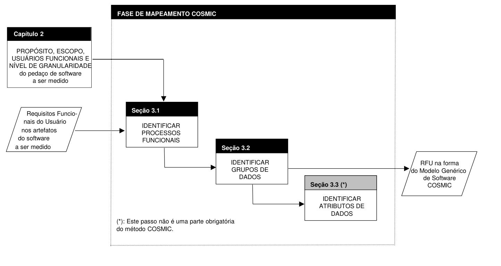
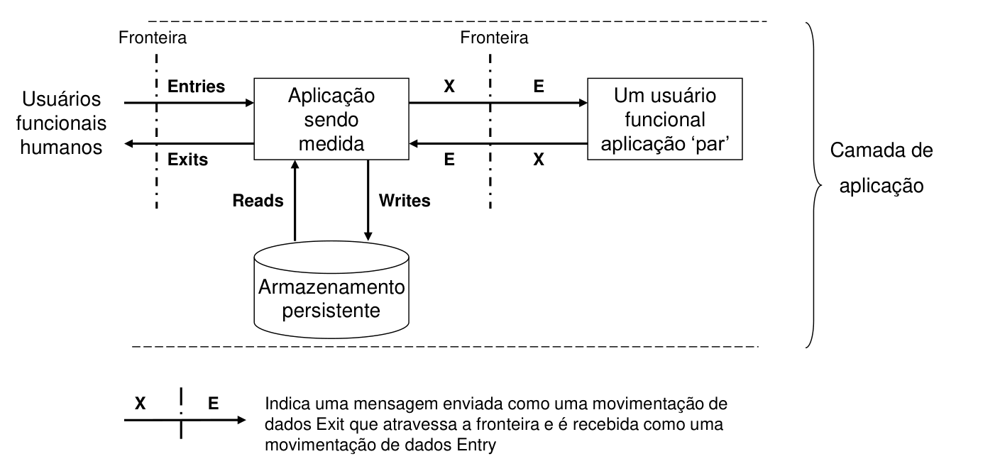
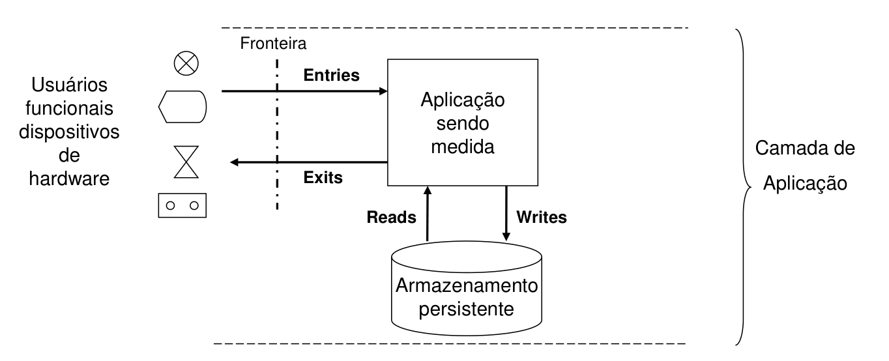
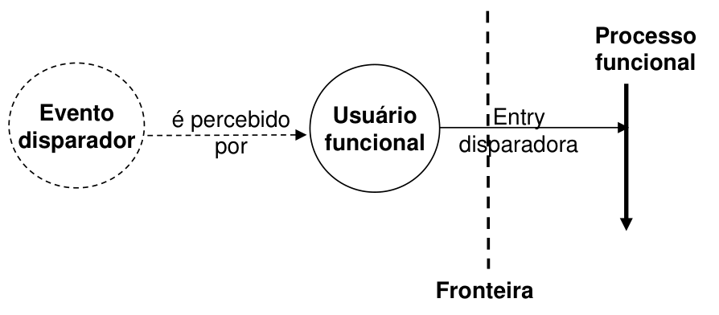

# 3 A Fase de Mapeamento

> Método COSMIC v3.0.1 — Manual de Medição

Este capítulo apresenta as regras e o método para o processo de mapeamento. O método geral para mapear software para o Modelo Genérico de Software COSMIC é resumido na Figura 3.0.

**Figura 3.0 – Método geral do processo de mapeamento de software COSMIC**

Cada passo neste método é o assunto de uma seção específica (indicada na barra de título do passo na figura 3) onde as definições e regras são apresentadas, acompanhadas de princípios e exemplos.

O método geral delineado na figura 3 acima foi projetado para ser aplicável a uma ampla gama de artefatos de software. Um processo mais sistemático e detalhado proveria regras de mapeamento precisas para uma coleção maior de artefatos altamente específicos, dessa forma diminuindo o nível de ambiguidade na geração do Modelo Genérico de Software COSMIC. Tal processo seria, por definição, altamente dependente da natureza dos artefatos, a qual, por sua vez, depende da metodologia de engenharia de software utilizada em cada organização.

O documento 'Guia para o Dimensionamento de Aplicações de Negócio utilizando COSMIC' fornece orientações sobre o mapeamento de vários métodos de análise de dados e determinação de requisitos para os conceitos do método COSMIC.

## 3.1 Aplicando o Modelo Genérico de Software

> **PRINCÍPIO – Aplicando o Modelo Genérico de Software COSMIC**
>
> O Modelo Genérico de Software COSMIC deve ser aplicado aos requisitos funcionais do usuário de cada pedaço de software distinto para o qual um escopo de medição distinto tenha sido definido.
>
> 'Aplicando o Modelo Genérico de Software COSMIC' diz respeito à identificação do conjunto de eventos disparadores percebidos por cada um dos (tipos de) usuários funcionais identificados nos RFU, seguida pela identificação dos correspondentes processos funcionais, objetos de interesse, grupos de dados e movimentações de dados que devem ser providos como resposta a esses eventos.

As Figuras 3.1.1 e 3.1.2 abaixo ilustram a aplicação do princípio (g) do Modelo de Contexto de Software e dos princípios do Modelo Genérico de Software a um pedaço de software de aplicação de negócio e a um pedaço típico de software 'real-time' embarcado, respectivamente.

Enquanto as Figuras 2.2.3.1 e 2.2.3.2 acima mostraram visões físicas reais das arquiteturas de software em camadas, respectivamente, estas Figuras 3.1.1 e 3.1.2 mostram uma visão lógica dos relacionamentos entre os vários conceitos definidos nos Modelos COSMIC. Nesta visão lógica os usuários funcionais interagem com o software a ser medido através de uma fronteira, via movimentações de dados do tipo Entry e Exit. O software movimenta dados de e para o armazenamento persistente via movimentações de dados do tipo Write e Read, respectivamente. Nestas visões lógicas são ignorados todo o hardware e software necessários para que tais trocas possam acontecer entre o software medido, seus usuários e o armazenamento persistente.

**Figura 3.1.1 – Uma aplicação de negócio com seres humanos e outra aplicação 'par' como seus usuários funcionais (visão lógica)**

**Figura 3.1.2 – Uma aplicação de software 'real-time' embarcado com vários dispositivos de hardware como seus usuários funcionais (visão lógica)**

## 3.2 Identificando processos funcionais

Este passo consiste em identificar o conjunto de processos funcionais do pedaço de software a ser medido, a partir de seus Requisitos Funcionais do Usuário.

### 3.2.1 Definições

> **DEFINIÇÃO – Processos funcionais**
>
> Um processo funcional é um componente elementar de um conjunto de Requisitos Funcionais do Usuário compreendendo um conjunto de movimentações de dados único, coeso e independentemente executável. É disparado por uma movimentação de dados (uma Entry) de um usuário funcional que informa ao pedaço de software que o usuário funcional identificou um evento disparador. Estará concluído quando tiver executado tudo o que é requerido para ser feito em resposta ao evento disparador.
>
> NOTA: Além de informar ao pedaço de software a ocorrência do evento, a 'Entry disparadora' deve incluir dados sobre o objeto de interesse associado ao mesmo.

> **DEFINIÇÃO – Evento disparador**
>
> Um evento (algo que acontece) que faz com que um usuário funcional do pedaço de software inicie ('dispare') um ou mais processos funcionais. Em um conjunto de Requisitos Funcionais do Usuário, cada evento que faz com que um usuário funcional dispare um processo funcional
>
> - não pode ser subdividido para aquele conjunto de RFU, e
> - aconteceu ou não aconteceu.
>
> NOTA: O relógio e eventos relativos ao passar do tempo podem ser eventos disparadores.

O relacionamento entre um evento disparador, o usuário funcional e a movimentação de dados Entry que dispara um processo funcional é mostrado na figura 3.2.1 abaixo. A interpretação deste diagrama é: *um evento é percebido por um usuário funcional e o usuário funcional dispara um processo funcional*.

**Figura 3.2.1 – Relação entre evento disparador, usuário funcional e processo funcional**

A Entry disparadora é normalmente uma mensagem positiva e não ambígua que informa ao software que o usuário funcional identificou um evento disparador. A Entry disparadora muitas vezes também inclui dados sobre um objeto de interesse associado ao evento. Depois de recebida a Entry disparadora, um processo funcional pode ser requerido para receber e processar outras Entries descrevendo outros objetos de interesse.

Se um usuário funcional enviar dados incorretos, p.ex., porque um usuário-sensor está funcionando mal ou um pedido submetido por um ser humano contém erros, cabe geralmente ao processo funcional determinar se o evento realmente ocorreu e/ou se os dados submetidos são realmente válidos e como responder.

### 3.2.2 A abordagem para a identificação de processos funcionais

A abordagem para a identificação de processos funcionais depende dos artefatos de software disponíveis para o medidor, o que por sua vez depende do ponto no ciclo de vida do software no qual a medição é requerida, bem como nos métodos de análise, projeto e desenvolvimento utilizados. Como estes últimos variam bastante mesmo dentro de um dado domínio de software, está além do escopo deste Manual de Medição prover um ou mais processos genéricos para a identificação de processos funcionais.

O 'Guia para a Medição do Tamanho de Software de Aplicações de Negócio utilizando COSMIC', seção 4.4, fornece mais regras e exemplos sobre como identificar e distinguir processos funcionais no domínio de software de aplicações de negócio.

A recomendação geral mais importante é: quase sempre, é útil tentar identificar os eventos distintos no mundo dos usuários funcionais a que o software deve responder, pois cada um desses eventos (tipo) normalmente dá origem a um (porém às vezes mais de um) processo funcional (tipo). Os eventos podem ser identificados em diagramas de estado e em diagramas de ciclo de vida de entidades, uma vez que cada transição com a qual o software precisa lidar corresponde a um evento.

Usar as seguintes regras para verificar se os processos funcionais candidatos foram corretamente identificados.

> **REGRAS – Processo funcional**
>
> a) Um processo funcional deve ser derivado de pelo menos um Requisito Funcional do Usuário identificável dentro do escopo acordado.
>
> b) Um processo funcional (tipo) deve ser executado quando um evento disparador identificável (tipo) ocorre.
>
> c) Um evento específico (tipo) pode disparar um ou mais processos funcionais (tipos) que executem em paralelo. Um processo funcional específico (tipo) pode ser disparado por mais de um evento (tipo).
>
> d) Um processo funcional deve compreender pelo menos duas movimentações de dados, uma Entry mais (uma Exit ou um Write).
>
> e) Um processo funcional deve pertencer completamente ao escopo de medição de um pedaço de software em uma e somente uma camada.
>
> f) No contexto de software 'real-time', um processo funcional deve ser considerado concluído quando o mesmo entra em um estado de espera auto-induzido (i.e., o processo funcional já fez tudo o que é requerido como resposta ao evento disparador e espera até receber a próxima Entry disparadora).
>
> g) Um processo funcional (tipo) deve ser identificado mesmo quando seus RFU permitirem que o referido processo funcional ocorra com diferentes subconjuntos de seu número máximo de atributos de dados de entrada, e mesmo que tais variações e/ou diferentes valores de dados de entrada possam dar origem a diferentes caminhos de processamento através do processo funcional.
>
> h) Eventos distintos (tipos) e consequentemente processos funcionais distintos (tipos) devem ser identificados separadamente nos seguintes casos:
>
> - Quando as decisões resultarem em eventos separados e desacoplados no tempo (p.ex., entrar com os dados do pedido hoje e mais tarde confirmar o aceite do pedido, requerendo uma decisão separada, deveria ser considerado como indicação de processos funcionais distintos),
> - Quando as responsabilidades pelas atividades estão separadas (p.ex., em um sistema de pessoal onde a responsabilidade pela manutenção dos dados básicos de pessoal e dos dados de pagamento estão separadas, indicando processos funcionais distintos; ou no caso de um pacote de software implementado onde há funcionalidades disponíveis para que um administrador de sistema mantenha os parâmetros do pacote, separadas das funcionalidades disponíveis para os usuários funcionais 'normais'.)

### 3.2.3 Eventos disparadores e processos funcionais no domínio de aplicações de negócio

a) Os eventos disparadores de uma aplicação 'on-line' de negócio geralmente ocorrem no mundo real do usuário funcional humano da aplicação. O usuário humano transmite a ocorrência do evento para um processo funcional submetendo dados a respeito do evento.

EXEMPLO 1: Em uma empresa, um pedido é recebido (evento disparador) fazendo com que um empregado (usuário funcional) submeta os dados do pedido (Entry disparadora transmitindo dados sobre um objeto de interesse, 'pedido'), como a primeira movimentação de dados do processo funcional 'entrada de pedido'.

b) Às vezes, para uma dada aplicação A pode existir uma aplicação par B que precise enviar/obter dados para/da aplicação A. Neste caso, se a aplicação B dispara um processo funcional quando precisa enviar/obter dados para/da aplicação A, então a aplicação B é um usuário funcional da aplicação A.

EXEMPLO 2: Suponhamos que, na recepção de um pedido no Exemplo (1), seja necessário que a aplicação de pedidos envie os detalhes do cliente a uma aplicação central de cadastramento de clientes, a qual está sendo medida. Agora, a aplicação de pedidos tornou-se um usuário funcional da aplicação central. A aplicação de pedidos percebe o evento de recebimento dos dados do cliente e dispara um processo funcional na aplicação central de cadastramento de clientes para armazenar esses dados, enviando dados sobre o objeto de interesse 'cliente' como uma Entry disparadora para a aplicação central.

c) A princípio não há diferença na análise de um processo funcional se for requerido que o mesmo seja processado em modo 'on-line' ou 'batch'. O processamento noturno é uma decisão sobre a implementação técnica, e 'tudo que é requerido fazer' não terá acontecido até que o processamento noturno tenha sido concluído. Uma cadeia de processamento 'batch' consiste de um ou mais processos funcionais (tipos), devendo cada qual ser analisado do início ao fim, independentemente de quaisquer outros processos funcionais na mesma cadeia. Cada processo funcional tem a sua própria Entry disparadora a ser medida.

EXEMPLO 3: Suponhamos que os pedidos no Exemplo 1 acima sejam submetidos 'on-line', mas sejam armazenados para processamento 'batch' automático noturno. O usuário funcional ainda é o ser humano que submeteu os pedidos 'on-line'; a Entry disparadora ainda é constituída pelos dados do pedido. Há um processo funcional para submissão e processamento dos pedidos.

d) Sinais periódicos de um relógio ('tiques do relógio') podem disparar fisicamente um processo funcional.

EXEMPLO 4: Suponhamos um RFU para um processamento 'batch' de final de ano a fim de reportar o resultado do negócio para o ano, e 'zerar' as posições para o início do ano seguinte. Fisicamente, um tique de final do ano do relógio gerado pelo sistema operacional inicia a cadeia 'batch', consistindo de um ou mais processos funcionais. Os processos funcionais na cadeia que utilizam dados de entrada na cadeia devem ser analisados normalmente (i.e., os dados de entrada para qualquer processo funcional compreendem uma ou mais Entries, a primeira das quais é a Entry disparadora para aquele processo).

Contudo, assumamos que há um processo funcional específico na cadeia que não requer dados de entrada para produzir seu conjunto de relatórios. Fisicamente, o usuário funcional (humano) delegou ao sistema operacional a tarefa de disparar este processo funcional. Como cada processo funcional deve possuir uma Entry disparadora, podemos considerar o tique de fim de ano do relógio que iniciou a cadeia 'batch' como fazendo este papel para este processo. Este processo funcional pode então precisar de vários Reads e Exits para produzir seus relatórios. Logicamente, a análise deste exemplo não mudará se o usuário funcional iniciar a produção de um ou mais relatórios através de um clique do 'mouse' sobre um item de menu, ao invés de delegar a produção do relatório ao sistema operacional através de uma cadeia 'batch'.

e) Um único evento pode disparar um ou mais processos funcionais que executem independentemente.

EXEMPLO 5: Um tique de final de semana do relógio inicia uma produção de relatórios, bem como o processo de revisão da expiração dos limites de tempo em um sistema de 'workflow'.

f) Um único processo funcional pode ser disparado por mais de um tipo de evento disparador.

EXEMPLO 6: Em um sistema bancário, um extrato completo pode ser disparado por processo 'batch' de final de mês, mas também por uma solicitação específica do cliente.

Para diversos exemplos sobre como distinguir eventos disparadores e processos funcionais em cadeias 'batch', ver o 'Guia para a Medição do Tamanho de Software de Aplicações de Negócio utilizando COSMIC', seção 4.6.3.

### 3.2.4 Eventos disparadores e processos funcionais no domínio de aplicações 'real-time'

a) Um evento disparador é tipicamente identificado por um sensor.

EXEMPLO 1: Quando a temperatura alcança um dado valor (evento disparador), um sensor (usuário funcional) envia um sinal (movimentação de dados por uma Entry disparadora) para ligar uma luz de advertência (processo funcional).

EXEMPLO 2: Uma aeronave militar possui um sensor que identifica o evento 'míssil se aproximando'. O sensor é um usuário funcional do software embarcado que precisa responder à ameaça. Para este software, um evento ocorre somente quando o sensor identifica alguma coisa, e é o sensor (usuário funcional) que dispara o software, enviando a este uma mensagem (Entry disparadora) dizendo, p.ex., 'o sensor 2 identificou um míssil', mais possivelmente uma cadeia de dados sobre a velocidade de aproximação do míssil e suas coordenadas. O objeto de interesse é o míssil.

b) Sinais periódicos de um relógio ('tiques do relógio') podem disparar um processo funcional.

EXEMPLO 3: Em alguns softwares de controle de processo em tempo real um tique (evento disparador) de um relógio (usuário funcional) faz com que o relógio envie um sinal (Entry disparadora), uma mensagem de um 'bit' que diz a um processo funcional que repita seu ciclo de controle normal. O processo funcional então lê vários sensores, recebendo dados sobre objetos de interesse, e executa qualquer ação necessária. Não há outros dados acompanhando o tique do relógio.

c) Um único evento pode disparar um ou mais processos funcionais que executam independentemente e em paralelo.

EXEMPLO 4: Uma condição de emergência identificada em uma usina nuclear pode disparar processos funcionais independentes em diversas partes da usina para baixar as hastes de controle, iniciar resfriamento de emergência, fechar válvulas, tocar alarmes, avisar os operadores, etc.

d) Um único processo funcional pode ser disparado por mais de um tipo de evento disparador.

EXEMPLO 5: A retração das rodas de uma aeronave pode ser disparada pelo sensor de 'peso fora do chão', ou pelo comando do piloto.

### 3.2.5 Mais sobre processos funcionais distintos

O software distingue os eventos e provê os processos funcionais correspondentes, dependendo apenas de seus RFU. No dimensionamento de software, às vezes pode ser difícil decidir quais são os eventos distintos que o software precisa reconhecer. Este é o caso principalmente quando os RFU originais não estão mais disponíveis e onde, por exemplo, o desenvolvedor pode ter achado econômico combinar diversos requisitos. Pode ser útil à análise examinar a organização dos dados de entrada (ver abaixo) ou examinar os menus de algum software instalado para ajudar a distinguir os eventos distintos aos quais o software deve responder e os processos funcionais correspondentes.

EXEMPLO 1: Quando há um requisito funcional do usuário relativo a créditos fiscais por um filho adicional e, também, relativo a 'créditos fiscais do trabalho' para pessoas de baixa renda, tais são requisitos para que o software responda a dois eventos separados no mundo dos usuários funcionais humanos. Dessa forma devem existir dois processos funcionais, embora um único formulário fiscal possa ter sido usado para capturar os dados de ambos os casos.

EXEMPLO 2: Se a renda em um caso (para uma pessoa) exceder o limite para o crédito fiscal do trabalho, e em outro caso (para uma pessoa diferente) isso não acontecer, tal diferença não dará origem a dois processos funcionais distintos, mas indicará duas condições distintas que serão tratadas no (único) processo funcional.

EXEMPLO 3: Como um exemplo da regra (g), se uma ocorrência de um evento específico disparar a Entry de um grupo de dados compreendendo os atributos de dados A, B e C, e o RFU permitir que outra ocorrência do mesmo evento dispare uma Entry de um grupo de dados que possui valores apenas para os atributos A e B, isto não resulta na identificação de dois processos funcionais (tipos). Apenas uma Entry e um processo funcional (tipo) serão identificados, movimentando e manipulando os atributos de dados A, B e C.

Uma vez identificado, cada processo funcional pode ser registrado em uma linha individual na camada ou componente par apropriado, na matriz do Modelo Genérico de Software (apêndice A), sob o rótulo correspondente.

### 3.2.6 Os processos funcionais de componentes pares

Quando o propósito de uma medição for medir separadamente o tamanho de cada componente par, um escopo de medição distinto deverá ser definido para cada componente par. Em tal caso, o dimensionamento dos processos funcionais de cada componente seguirá todas as regras normais já descritas.

A partir do processo utilizado em cada medição (... definir o escopo, os usuários funcionais e a fronteira, etc...) segue que se um pedaço de software consistir de dois ou mais componentes pares, não poderá existir nenhuma superposição entre os escopos de medição dos componentes. O escopo de medição de cada componente deverá definir um conjunto completo de processos funcionais. Por exemplo, não poderá existir um processo funcional com parte em um escopo e parte em outro. Da mesma forma, os processos funcionais dentro do escopo de medição de um componente não têm conhecimento dos processos funcionais dentro do escopo de outro componente, embora os dois componentes troquem mensagens.

Os usuários funcionais de cada componente são determinados examinando-se onde ocorrem os eventos que disparam processos funcionais no componente examinado. (Eventos disparadores só podem ocorrer no mundo de um usuário funcional.)

A Figura 4.1.8.2 ilustra os processos funcionais de dois componentes pares e as movimentações de dados que os mesmos trocam.

## 3.3 Identificando objetos de interesse e grupos de dados

### 3.3.1 Definições e princípios

Este passo consiste em identificar os grupos de dados referenciados pelo pedaço de software sendo medido. Para identificar grupos de dados, especialmente no domínio de software de aplicações de negócio, geralmente é útil identificar os objetos de interesse e provavelmente também os seus atributos. Os grupos de dados são movimentados através de 'movimentações de dados' identificadas no próximo capítulo.

> **DEFINIÇÃO – Objeto de interesse**
>
> Qualquer 'coisa' que é identificada do ponto de vista dos Requisitos Funcionais do Usuário. Pode ser qualquer coisa física, assim como qualquer objeto conceitual ou parte de um objeto conceitual no mundo do usuário funcional, a respeito do qual o software deve processar e/ou armazenar dados.
>
> NOTA: No método COSMIC o termo 'objeto de interesse' é utilizado a fim de evitar termos relacionados a métodos específicos da engenharia de software. O termo não diz respeito a 'objetos' no sentido usado pelos métodos Orientados a Objetos.

> **DEFINIÇÃO – Grupo de dados**
>
> Um grupo de dados é um conjunto de atributos de dados distinto, não vazio, não ordenado e não redundante, onde cada atributo de dado incluído descreve um aspecto complementar do mesmo objeto de interesse.

> **DEFINIÇÃO – Armazenamento persistente**
>
> O armazenamento persistente é o armazenamento que permite a um processo funcional armazenar um grupo de dados além da vida do processo funcional, e/ou de onde um processo funcional pode recuperar um grupo de dados armazenado por outro processo funcional, por uma ocorrência anterior do mesmo processo funcional, ou por algum outro processo.
>
> NOTA 1: No modelo COSMIC o armazenamento persistente não é considerado um usuário do software, por residir no mesmo lado da fronteira que o software.
>
> NOTA 2: Um exemplo de 'algum outro processo' seria a fabricação de memória 'read-only'.

Uma vez identificado, cada grupo de dados candidato deve obedecer aos seguintes princípios:

> **PRINCÍPIOS – Grupo de dados**
>
> a) Cada grupo de dados identificado deve ser único e distinguível através de sua coleção única de atributos de dados
>
> b) Cada grupo de dados deve ser diretamente relacionado a um objeto de interesse nos Requisitos Funcionais do Usuário
>
> c) Um grupo de dados deve ser materializado dentro do sistema de computador que suporta o software.

Uma vez identificado, cada grupo de dados pode ser registrado em uma coluna individual da matriz do Modelo Genérico de Software (apêndice A), sob o rótulo correspondente.

### 3.3.2 Sobre a materialização de um grupo de dados

Na prática, a materialização de um grupo de dados pode assumir várias formas, por exemplo:

a) Como uma estrutura física de registros em um dispositivo persistente (arquivo, tabela de banco de dados, memória ROM, etc.).

b) Como uma estrutura física dentro da memória volátil do computador (estrutura de dados alocada dinamicamente ou através de um bloco de memória pré-alocado).

c) Como a apresentação conjunta de atributos de dados funcionalmente relacionados, em um dispositivo de entrada/saída (tela de vídeo, relatório impresso, tela de um painel de controle, etc.).

d) Como uma mensagem na transmissão entre um dispositivo e um computador, em uma rede, etc.

### 3.3.3 Sobre a identificação de objetos de interesse e grupos de dados

A definição e os princípios referentes a objetos de interesse e grupos de dados são intencionalmente genéricos para que sejam aplicáveis à faixa de software mais ampla que for possível. Esta característica por vezes faz com que seja difícil aplicar as definições e princípios à medição de um pedaço de software específico. Dessa forma, os exemplos seguintes foram projetados para auxiliar a aplicação dos princípios a casos específicos.

Diante da necessidade de analisar um grupo de atributos de dados que é movimentado para dentro ou para fora de um processo funcional, ou movimentado por um processo funcional para dentro ou para fora do armazenamento persistente, é criticamente importante decidir se todos os atributos transmitem dados sobre um único 'objeto de interesse', pois é este último que determina o número de 'grupos de dados' distintos, conforme definido pelo método COSMIC. Por exemplo, se os atributos de dados a serem submetidos a um processo funcional são atributos de três objetos de interesse distintos, então precisaremos identificar três movimentações de dados do tipo 'Entry' distintas.

#### Objetos de interesse e grupos de dados no domínio de aplicações de negócio

EXEMPLO 1: No domínio de software de aplicações de negócio, um objeto de interesse poderia ser 'empregado' (físico) ou 'pedido (conceitual), supondo que o software precise armazenar dados sobre empregados ou pedidos. No caso do 'pedido', decorre normalmente do RFU correspondente a pedidos com várias linhas que dois objetos de interesse serão identificados: 'pedido' e 'linha do pedido'. Os grupos de dados correspondentes poderiam ser denominados 'dados do pedido' e 'dados da linha do pedido'.

Grupos de dados são formados sempre que há uma consulta 'ad hoc' que solicita dados sobre alguma 'coisa' a respeito da qual não são mantidos dados no armazenamento persistente, mas que podem ser derivados dos dados mantidos no armazenamento persistente. A movimentação de dados Entry em uma consulta 'ad hoc' (os parâmetros de seleção para derivar os dados requeridos) e a movimentação de dados Exit (contendo os atributos desejados) movimentam grupos de dados sobre uma dessas 'coisas'. Esses são grupos de dados transientes que não sobrevivem à execução do processo funcional. São grupos de dados válidos porque atravessam a fronteira entre o software e o(s) seu(s) usuário(s).

EXEMPLO 2: Seja uma consulta 'ad hoc' contra um banco de dados de pessoal para extrair uma lista de nomes de todos os empregados acima de 35 anos. A Entry movimenta um grupo de dados contendo os parâmetros de seleção. A Exit movimenta um grupo de dados contendo o atributo individual 'nome'; o 'objeto de interesse' (ou 'coisa') é 'todos os empregados acima de 35 anos de idade'. Ao registrar o processo funcional, é importante denominar claramente um grupo de dados transiente em relação ao seu objeto de interesse, ao invés de relacioná-lo ao(s) objeto(s) de interesse a partir do(s) qual(is) o resultado da consulta 'ad hoc' é derivado.

Para uma discussão detalhada sobre os métodos de análise de dados para determinar objetos de interesse e grupos de dados distintos, o leitor é remetido ao 'Guia para a Medição do Tamanho de Software de Aplicações de Negócio usando COSMIC'.

#### Objetos de interesse e grupos de dados no domínio de software 'real-time'

EXEMPLO 3: Movimentos de dados que são Entries de dispositivos físicos tipicamente contém dados sobre o estado de um único objeto de interesse, por exemplo: se uma válvula está aberta ou fechada, ou indicam um momento no qual os dados contidos na memória volátil de curto prazo estarão válidos ou inválidos, ou se a mesma contém dados que indicam que um evento crítico ocorreu – o que causa uma interrupção. Da mesma forma, um comando Exit para ligar/desligar uma luz de advertência transmite dados sobre um único objeto de interesse.

EXEMPLO 4: Um comutador de mensagens poderia receber um grupo de dados de mensagem como uma Entry e roteá-la sem modificações como uma Exit, de acordo com o RFU desse pedaço de software específico. Os atributos do grupo de dados de mensagem poderiam ser, por exemplo, 'remetente, destinatário, código de rota e conteúdo da mensagem'; o objeto de interesse da mensagem é 'mensagem'.

EXEMPLO 5: Uma estrutura de dados comum, representando objetos de interesse mencionados nos Requisitos Funcionais do Usuário, que pode ser mantida por processos funcionais, e que é acessível à maior parte dos processos funcionais encontrados no software medido.

EXEMPLO 6: Uma estrutura de dados de referência, representando gráficos ou tabelas de valores encontrados nos Requisitos Funcionais do Usuário, que é mantida na memória permanente (memória ROM, por exemplo) e que é acessível à maioria dos processos funcionais encontrados no software medido.

EXEMPLO 7: Arquivos, comumente denominados arquivos 'flat' ('planos'), representando objetos de interesse mencionados nos Requisitos Funcionais do Usuário, que são mantidos em um dispositivo de memória persistente.

### 3.3.4 Dados ou grupos de dados que não são candidatos a movimentações de dados

Quaisquer dados aparecendo nas telas ou relatórios de entrada ou saída que não sejam relacionados a um objeto de interesse de um usuário funcional não deveriam ser identificados como indicando uma movimentação de dados, e dessa forma não deveriam ser medidos.

EXEMPLO 1: Dados gerais de aplicação tais como cabeçalhos e rodapés (nome da empresa, nome da aplicação, data do sistema, etc.) aparecendo em todas as telas

EXEMPLO 2: Comandos de controle (um conceito definido somente no domínio de aplicações de negócio) que permitem a um usuário funcional controlar o uso do software, em vez de movimentar dados, por exemplo: comandos de paginação, clicar 'OK' para reconhecer uma mensagem de erro, etc. – ver adiante a seção 4.1.10.

O Modelo Genérico de Software COSMIC assume que toda a manipulação de dados dentro de um processo funcional está associada a um de quatro tipos de movimentações de dados – ver seção 4.1.6. Dessa forma, nenhum movimento ou manipulação de dados dentro de um processo funcional pode ser identificado como candidato a alguma movimentação de dados em acréscimo a Entries, Exits, Reads e Writes. (Para exemplos de manipulações e movimentos de dados que podem ser erradamente interpretados como movimentações de dados, ver a seção 4.1.4, princípio (c) para um Read e seção 4.1.5 princípio (d) para um Write).

### 3.3.5 O usuário funcional como um objeto de interesse

Em muitos sistemas de software 'real-time' simples, tal como o descrito no Exemplo 3 da seção 3.3.3 acima, é impossível distinguir o dispositivo físico – um usuário funcional – do objeto de interesse da movimentação de dados que ele gera ou recebe. Em tais casos é de pouco valor documentar um objeto de interesse como se fosse algo distinto do usuário funcional. O ponto importante é utilizar esses conceitos, quando úteis, para identificar os grupos de dados distintos e assim separar as movimentações de dados.

EXEMPLO: Seja um sensor de temperatura 'A' que, quando consultado por um processo funcional, envia ao mesmo a temperatura atual. O usuário funcional é o sensor A; o nome da mensagem Entry poderia ser 'temperatura atual em A'; o objeto de interesse desta mensagem poderia também ser visto como 'sensor A'. Teoricamente, o objeto de interesse não é o 'sensor A', mas sim 'o material ou objeto cuja temperatura está sendo percebida pelo sensor A'. Na prática, contudo, acrescenta pouco valor documentar tais distinções sutis, podendo não valer a pena identificar o objeto de interesse separadamente.

## 3.4 Identificando atributos de dados (opcional)

Esta seção discute a identificação de atributos de dados referenciados pelo pedaço de software a ser medido. Nesta versão do método de medição, não é obrigatório identificar os atributos de dados. Contudo, pode ser útil analisar e identificar os atributos de dados no processo de distinguir grupos de dados e objetos de interesse. Os atributos de dados também podem ser identificados se for requerida uma subunidade da medida de tamanho, conforme apresentado na seção 4.5, 'Ampliando o método de medição COSMIC'.

### 3.4.1 Definição

> **DEFINIÇÃO – Atributo de Dados**
>
> Um atributo de dados é a menor parcela de informação, dentro de um grupo de dados identificado, que possui um significado segundo a perspectiva dos Requisitos Funcionais do Usuário do software.

EXEMPLO 1: Atributos de dados no contexto do domínio das aplicações de negócio são, por exemplo, elementos de dados cadastrados no dicionário de dados e atributos de dados que aparecem em um modelo de dados conceitual ou lógico.

EXEMPLO 2: Atributos de dados no contexto do software de aplicação 'real-time' são, por exemplo, atributos de dados de um sinal recebido de um sensor e atributos de dados de uma mensagem em transmissão.

### 3.4.2 Sobre a associação de atributos de dados e grupos de dados

Na teoria, um grupo de dados pode conter apenas um atributo de dados se isto for suficiente para descrever o objeto de interesse, segundo a perspectiva dos Requisitos Funcionais do Usuário. Na prática, tais casos ocorrem comumente no software de aplicação 'real-time' (p.ex., a Entry transmitindo o tique de um relógio em tempo real); são menos comuns no software de aplicação de negócio.
