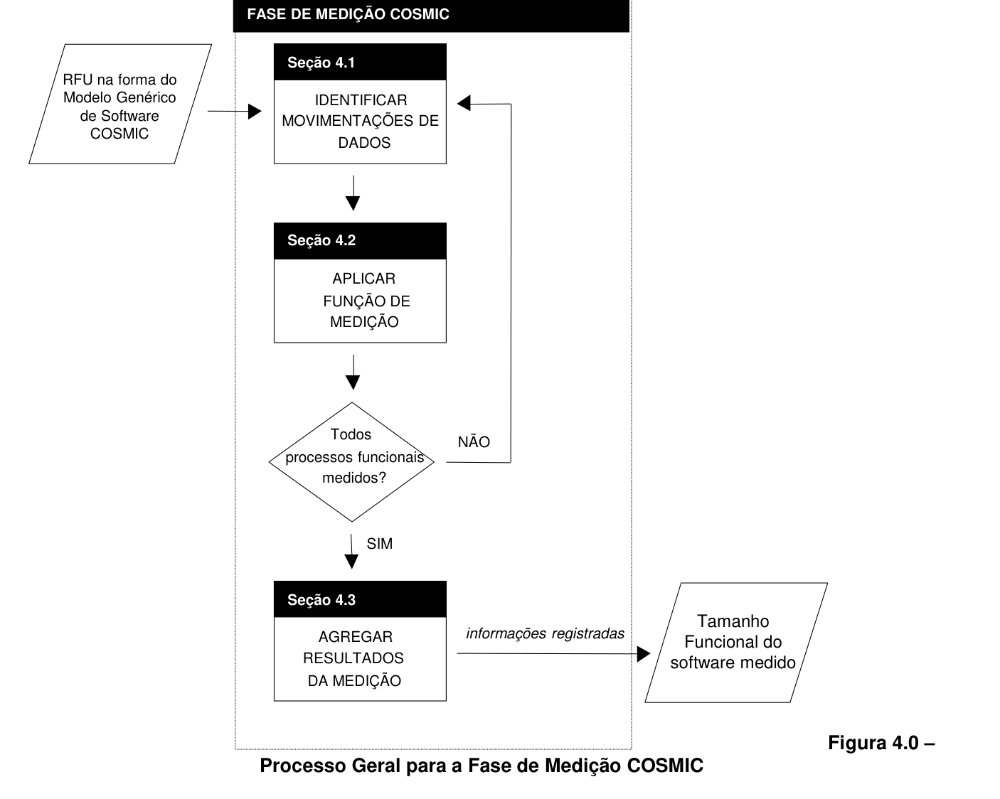
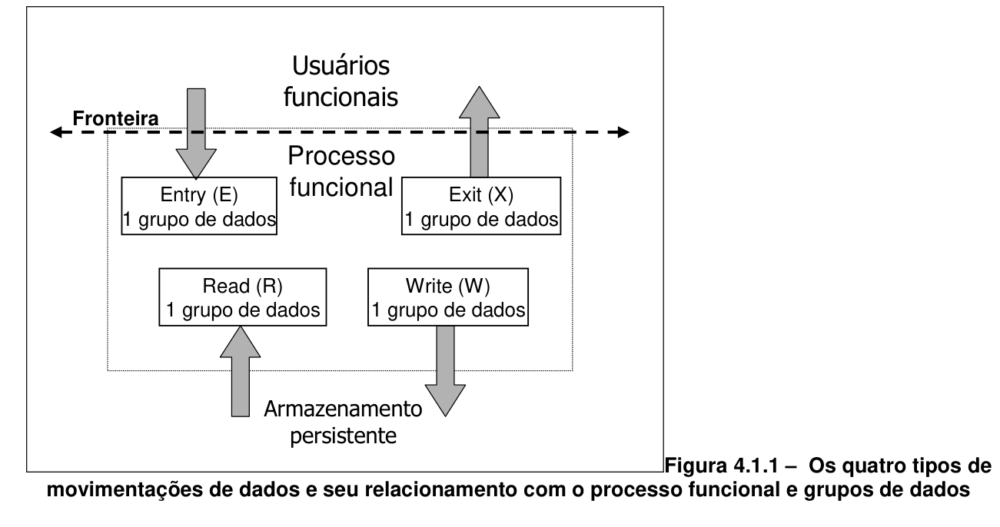
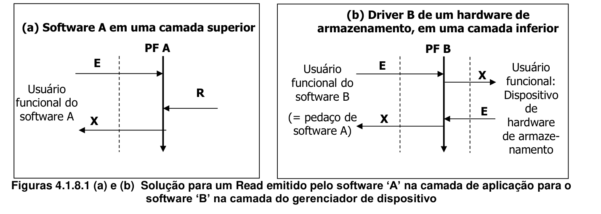
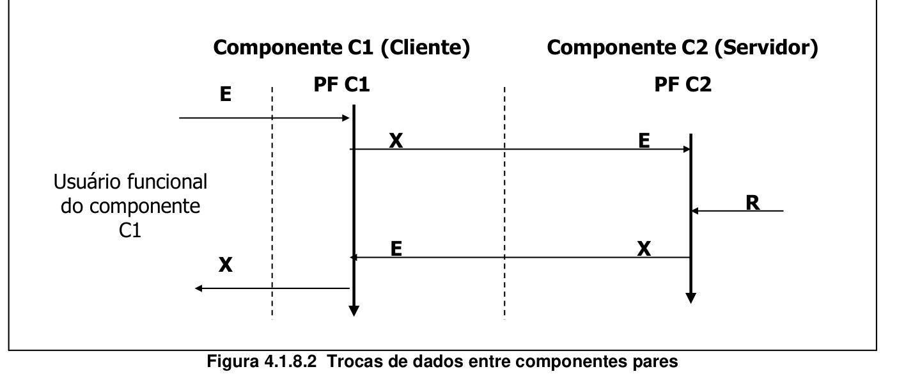
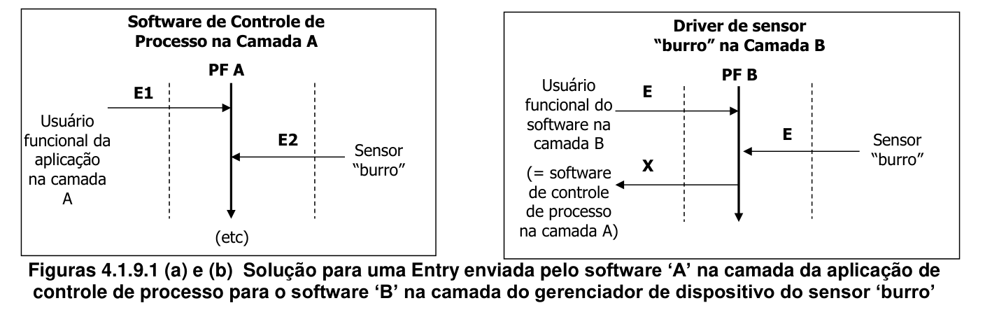

# 4 A Fase de Medição

> Método COSMIC v3.0.1 — Manual de Medição

Este capítulo apresenta as regras e o método para a fase de medição do processo de medição COSMIC. O método geral para a medição de um pedaço de software cujos Requisitos Funcionais do Usuário estejam expressos em termos do Modelo Genérico de Software COSMIC é resumido na Figura 4.0 abaixo.

Cada passo neste método é o assunto de uma seção específica neste capítulo, onde as definições e princípios a aplicar são apresentados, juntamente com algumas regras e exemplos.

## 4.1 Identificando as movimentações de dados

Este passo consiste na identificação das movimentações de dados (Entry, Exit, Read e Write) de cada processo funcional.

### 4.1.1 Definição dos tipos de movimentações de dados

> **DEFINIÇÃO – Movimentação de dados**
>
> Um componente funcional básico que movimenta um único tipo de grupo de dados.
>
> NOTA 1: Há quatro subtipos de tipos de movimentações de dados: Entry, Exit, Read e Write (tipos de).
>
> NOTA 2: Para fins de medição, considera-se que cada subtipo de movimentação de dados inclui certas manipulações de dados associadas – ver a seção 4.1.6.
>
> NOTA 3: De uma forma mais precisa, trata-se de uma *ocorrência* de uma movimentação de dados, e não de um *tipo* de movimentação de dados, que realmente *movimenta* as *ocorrências* do grupo de dados (não os *tipos*). Este comentário também se aplica às definições de Entry, Exit, Read e Write.

> **DEFINIÇÃO – Entry (E)**
>
> Uma Entry (E) é uma movimentação de dados que movimenta um grupo de dados de um usuário funcional através da fronteira para dentro do processo funcional no qual o mesmo é requerido.
>
> NOTA: Considera-se que uma Entry (tipo) inclui certas manipulações de dados associadas (ver seção 4.1.6).

> **DEFINIÇÃO – Exit (X)**
>
> Uma Exit (X) é uma movimentação de dados que movimenta um grupo de dados de um processo funcional através da fronteira na direção do usuário funcional que o requisita.
>
> NOTA: Considera-se que uma Exit inclui certas manipulações de dados (ver seção 4.1.6).

> **DEFINIÇÃO – Read (R)**
>
> Uma movimentação de dados que movimenta um grupo de dados do armazenamento persistente para dentro do processo funcional que dele necessita.
>
> NOTA: Considera-se que um Read (tipo) inclui certas manipulações de dados associadas (ver seção 4.1.6).

> **DEFINIÇÃO – Write (W)**
>
> Uma movimentação de dados que movimenta um grupo de dados do interior de um processo funcional para o armazenamento persistente.
>
> NOTA: Considera-se que um Write (tipo) inclui certas manipulações de dados associadas (ver seção 4.1.6).

A Figura 4.1.1. abaixo ilustra o relacionamento global entre os quatro tipos de movimentações de dados, o processo funcional ao qual pertencem e a fronteira do software medido.

### 4.1.2 Identificando Entries (E)

Uma vez identificada, uma movimentação de dados Entry candidata deve estar em conformidade com os seguintes princípios:

> **PRINCÍPIOS – Entry (E)**
>
> a) Uma Entry deve movimentar um único grupo de dados descrevendo um único objeto de interesse de um usuário funcional através da fronteira e para dentro do processo funcional do qual a Entry faz parte. Se a entrada para um processo funcional compreender mais de um grupo de dados, identificar uma Entry para cada grupo de dados distinto na entrada. (Ver tambem a seção 4.1.7 sobre 'Unicidade nas movimentações de dados'.)
> b) Uma Entry não deve enviar dados para fora da fronteira, ler ou gravar dados.
> c) Quando um processo funcional precisar obter dados de um usuário funcional e este último não precisar saber quais dados enviar, ou quando o usuário funcional for incapaz de reagir a uma mensagem a ele destinada, identificar uma Entry para o processo funcional pela obtenção dos dados. Nenhuma mensagem do processo funcional ao usuário funcional procurando recuperar os dados deve ser contada como Exit nesses casos.
>
>    Contudo, quando um processo funcional precisar obter dados de um usuário funcional e o processo funcional precisar fornecer dados ao usuário funcional, dos quais este último precise para atender ao solicitado, contar uma Exit para a solicitação e uma Entry para o retorno dos dados solicitados (ver seção 4.1.9 adiante).

As seguintes regras ajudam a confirmar a situação de uma movimentação de dados Entry candidata:

> **REGRAS – Entry (E)**
>
> a) O grupo de dados de uma Entry disparadora pode consistir de apenas um atributo de dados que simplesmente informe ao software que 'um evento Y ocorreu'. Muitas vezes, principalmente em software de aplicações de negócio, o grupo de dados da Entry disparadora possui diversos atributos que informam ao software que 'um evento Y ocorreu e aqui estão os dados sobre aquele evento específico'.
> b) Tiques de relógio que sejam eventos disparadores devem ser sempre externos ao software sendo medido. Assim, por exemplo, um evento tique de relógio ocorrendo a cada 3 segundos deve estar associado a uma Entry movimentando um grupo de dados com um atributo de dados. Notar que não faz diferença se o evento disparador é gerado periodicamente pelo hardware ou por outro pedaço de software fora da fronteira do software sendo medido.
> c) A não ser que um processo funcional específico seja necessário, obter a hora a partir do relógio do sistema não deve ser considerado como causa de uma Entry.
> d) Se uma ocorrência de um evento específico disparar a Entry de um grupo de dados compreendendo até 'n' atributos de dados de certo objeto de interesse e o RFU permitir que outras ocorrências do mesmo evento possam disparar uma Entry de um grupo de dados, com valores apenas para um subconjunto dos 'n' atributos do objeto de interesse, então uma Entry deverá ser identificada compreendendo todos os 'n' atributos de dados.

EXEMPLO ilustrando a regra (c): quando um processo funcional grava uma 'time stamp', nenhuma Entry é identificada para obter o valor do relógio do sistema.

Uma vez identificada, cada movimentação de dados Entry pode ser registrada marcando-se a célula correspondente da matriz do Modelo Genérico de Software (apêndice A) com um 'E'.

### 4.1.3 Identificar Exits (X)

Uma vez identificada, uma movimentação de dados Exit candidata deve estar em conformidade com os seguintes princípios:

> **PRINCÍPIOS – Exit (X)**
>
> a) Uma Exit deve movimentar um único grupo de dados, descrevendo um único objeto de interesse do processo funcional do qual a Exit faz parte, através da fronteira para um usuário funcional. Se a saída de um processo funcional compreender mais de um grupo de dados, identificar uma Exit para cada grupo de dados distinto na saída. (Ver também a seção 4.1.7 sobre 'Unicidade nas movimentações de dados'.)
> b) Uma Exit não deve enviar dados para dentro da fronteira, ler ou gravar dados.

As seguintes regras podem ser úteis para confirmar a situação de uma movimentação de dados Exit candidata:

> **REGRAS – Exit (X)**
>
> a) Todas as mensagens geradas e enviadas por software sem dados do usuário (p.ex., mensagens de erro) devem ser consideradas como valores de um atributo de um objeto de interesse (o qual poderia ser denominado 'indicação de erro'). Dessa forma, uma única Exit deve ser identificada para representar todas essas ocorrências de mensagens dentro de cada processo funcional onde as mesmas sejam requeridas pelo RFU.
> b) Se uma Exit de um processo funcional movimenta um grupo de dados compreendendo até 'n' atributos de dados de certo objeto de interesse e o RFU permite que o processo funcional possua a ocorrência de uma Exit que movimente um grupo de dados com valores apenas para um subconjunto dos 'n' atributos do objeto de interesse, então uma Exit deverá ser identificada, compreendendo todos os 'n' atributos de dados.

Exemplos da regra (a) acima são apresentados a seguir:

EXEMPLO 1: Em um diálogo humano-computador, alguns exemplos de mensagens de erro ocorrendo durante a validação dos dados submetidos poderiam ser: 'erro de formato', 'cliente não encontrado', 'erro: caixa de verificação indicando que os termos e condições foram lidos', 'limite de crédito excedido', etc. Todas essas mensagens de erro devem ser consideradas ocorrências de uma Exit em cada processo funcional onde tais mensagens ocorram (que poderia ser denominada 'mensagens de erro').

EXEMPLO 2: Mensagens de erro enviadas aos usuários humanos e não geradas pelo software aplicativo devem ser completamente ignoradas na medição da aplicação. Um exemplo de tal tipo de mensagem enviada pelo sistema operacional poderia ser 'A impressora X não está respondendo'.

EXEMPLO 3: Em um diálogo humano-computador, se uma mensagem é enviada em situações de erro, mas contém dados do usuário funcional, então a mesma deveria ser contada como uma Exit no processo funcional onde ocorre. Um exemplo de tal mensagem poderia ser 'Aviso: a quantia que você quer sacar excede o seu limite em $100' (onde $100 é uma variável calculada). Neste exemplo, a Exit contém um grupo de dados relacionado à conta bancária do cliente.

EXEMPLO 4: Em um sistema 'real-time', um processo funcional que verifica periodicamente o funcionamento correto de todos os dispositivos de hardware poderia enviar uma mensagem do tipo 'O sensor X falhou', onde X é uma variável. Tal mensagem deveria ser identificada como uma Exit naquele processo funcional (independentemente do valor de 'X').

EXEMPLO 5: Consideremos os processos funcionais A e B. 'A' pode enviar potencialmente 2 mensagens de confirmação distintas e 5 mensagens de erro aos seus usuários funcionais, enquanto 'B' pode enviar potencialmente 8 mensagens de erro aos seus usuários funcionais. Neste exemplo, uma Exit deve ser identificada no processo funcional 'A' (lidando com 5+2=7 mensagens) e uma Exit distinta deve ser identificada no processo funcional 'B' (lidando com 8 mensagens).

Uma vez identificada, cada movimentação de dados Exit pode ser registrada marcando-se a correspondente célula da matriz do Modelo Genérico de Software (apêndice A) com um 'X'.

### 4.1.4 Identificando Reads (R)

Uma vez identificada, uma movimentação de dados Read candidata deve estar em conformidade com os seguintes princípios:

> **PRINCÍPIOS – Read (R)**
>
> a) Um Read deve movimentar um único grupo de dados descrevendo um único objeto de interesse do armazenamento persistente para um processo funcional do qual o Read faz parte. Se o processo funcional precisar recuperar mais do que um grupo de dados do armazenamento persistente, identificar um Read para cada grupo de dados distinto recuperado. (Ver também seção 4.1.7 sobre 'Unicidade na movimentação de dados'.)
> b) Um Read não deve receber ou enviar dados para fora da fronteira, ou gravar dados.
> c) Durante um processo funcional, a movimentação ou manipulação de constantes ou variáveis internas ao processo funcional que possam ser alteradas somente por um programador, o cálculo de resultados intermediários, ou de dados armazenados por um processo funcional como resultado apenas da implementação e não dos RFU não devem ser consideradas movimentações de dados Read.
> d) Uma movimentação de dados Read sempre inclui qualquer funcionalidade do tipo 'solicitação de leitura' (assim uma movimentação de dados distinta nunca será contada para uma funcionalidade do tipo 'solicitação de leitura'). Ver também a seção 4.1.9.

Uma vez identificada, cada movimentação de dados Read pode ser registrada marcando-se a célula correspondente da matriz do Modelo Genérico de Software (apêndice A) com um 'R'.

### 4.1.5 Identificando Writes (W)

Uma vez identificada, uma movimentação de dados Write candidata deve estar em conformidade com os seguintes princípios:

> **PRINCÍPIOS – Write (W)**
>
> a) Um Write deve movimentar um único grupo de dados para o armazenamento persistente, descrevendo um único objeto de interesse do processo funcional do qual o Write faz parte. Se o processo funcional precisar movimentar mais de um grupo de dados para o armazenamento persistente, identificar um Write para cada grupo de dados distinto que for movimentado para o armazenamento persistente. (Ver também a seção 4.1.7 sobre 'Unicidade nas movimentações de dados'.)
> b) Um Write não deve receber ou enviar dados através da fronteira, ou ler dados.
> c) Um requisito para excluir um grupo de dados do armazenamento persistente deve ser medido como uma única movimentação de dados Write.
> d) No decorrer de um processo funcional, movimentações ou manipulações de dados que não persistirem quando o processo funcional estiver concluído, que atualizem variáveis internas ao processo funcional, ou que produzam resultados intermediários em um cálculo não devem ser consideradas movimentações de dados Write.

Uma vez identificada, cada movimentação de dados Write pode ser registrada marcando-se a célula correspondente da matriz do Modelo Genérico de Software (apêndice A) com um 'W'.

### 4.1.6 Sobre as manipulaçoes de dados associadas a movimentações de dados

Os subprocessos são, conforme definido no princípio (d) do Modelo Genérico de Software (ver seção 1.4), movimentações de dados ou manipulações de dados. Entretanto, de acordo com uma convenção COSMIC vigente (ver princípio (j) do Modelo Genérico de Software), a existência distinta de subprocessos de manipulação de dados não é reconhecida.

> **DEFINIÇÃO – Manipulação de dados**
>
> Qualquer coisa que aconteça aos dados que não seja a movimentação dos mesmos para dentro ou para fora de um processo funcional, ou entre um processo funcional e o armazenamento persistente.

O seguinte princípio determina como o método COSMIC trata a manipulação de dados.

> **PRINCÍPIO – Manipulações de dados associadas a movimentações de dados**
>
> Todas as manipulações de dados em um processo funcional devem estar associadas aos quatro tipos de movimentações de dados (E, X, R e W). Por convenção, assume-se que as movimentações de dados de um processo funcional também representam as manipulações de dados do processo funcional.

A necessidade de definir os tipos de manipulações de dados associados aos tipos de movimentações de dados surge apenas na medição de *mudanças* no software (ver seção 4.4). Uma mudança requerida geralmente afeta tanto os atributos movimentados quanto a manipulação associada a uma movimentação específica, mas *pode* afetar apenas a manipulação dos dados e não a movimentação dos dados. Tal mudança também precisa ser identificada e medida. Dessa forma, quando há um requisito para mudar uma manipulação de dados em um processo funcional, o medidor precisa identificar a movimentação de dados associada à mudança na manipulação de dados.

Abaixo estão orientações gerais para identificar as manipulações de dados representadas por cada uma das movimentações de dados.

**Movimentação de dados Entry**

Uma Entry inclui todas as manipulações de dados

- para permitir que um grupo de dados seja submetido e validado por um usuário funcional (p.ex., manipulações de formatação e validação)
- mas não inclui manipulações que envolvam uma outra movimentação de dados, nem manipulações depois que o grupo de dados tenha sido submetido e validado.

EXEMPLO: Uma Entry inclui todas as manipulações, formatações e apresentações em uma tela dos dados submetidos, EXCETO quaisquer Reads que sejam requeridos para validar códigos submetidos ou obter as descrições a eles associadas.

Uma movimentação de dados Entry inclui qualquer funcionalidade do tipo 'solicitação de entrada' exceto quando o processo funcional precisar informar ao usuário funcional quais dados enviar (ver seção 4.1.9 para os dados que devem ser enviados e 4.1.10 para tratamento de uma tela de entrada vazia).

**Movimentação de dados Exit**

Uma Exit inclui todas as manipulações de dados

- para criar os atributos de dados de um grupo de dados a ser enviado à saída e/ou
- tornar possível que o grupo de dados seja enviado à saída (p.ex., manipulações de formatação e apresentação) e direcionado ao usuário funcional de destino
- mas não inclui nenhuma manipulação de dados que envolva outra movimentação de dados.

EXEMPLO: Uma Exit inclui todo o processamento para formatar e preparar para a impressão alguns atributos de dados, incluindo os campos de títulos que podem ser lidos por seres humanos[^13], EXCETO quaisquer Reads ou Entries que possam sejam requeridos para suprir os valores ou descrições de alguns dos atributos de dados impressos.

**Movimentação de dados Read**

Um Read inclui todo o processamento e/ou cálculo necessários para recuperar um grupo de dados do armazenamento persistente, mas não quaisquer manipulações que envolvam outros tipos de movimentações de dados, nem quaisquer manipulações depois que o Read tenha sido concluído com sucesso.

EXEMPLO: Um Read inclui todos os cálculos matemáticos e processamento lógico requeridos para recuperar um grupo de dados do armazenamento persistente, mas não a manipulação desses atributos depois que o grupo de dados tiver sido obtido.

Um Read também inclui sempre qualquer funcionalidade do tipo 'solicitação para ler' (ver seção 4.1.9).

**Movimentação de dados Write**

Um Write inclui todo o processamento e/ou cálculo para criar um grupo de dados a ser gravado, mas não inclui quaisquer manipulações que envolvam outros tipos de movimentações de dados, nem quaisquer manipulações depois que o Write tenha sido concluído com sucesso.

EXEMPLO: Um Write inclui todos os cálculos matemáticos e processamento lógico requeridos para criar ou atualizar um grupo de dados a ser gravado ou excluído, EXCETO quaisquer Reads ou Entries que possam ser requeridos para fornecer os valores de quaisquer atributos de dados incluídos no grupo a ser gravado ou excluído.

### 4.1.7 Unicidade nas movimentações de dados e possíveis exceções[^14]

O Modelo Genérico de Software assume que, normalmente, em qualquer processo funcional, todos os dados descrevendo qualquer objeto de interesse requerido pelo mesmo são submetidos através de um tipo de movimentação de dados Entry, e/ou lidos através de um tipo de movimentação de dados Read, e/ou gravados através de um tipo de movimentação de dados Write, e/ou apresentados através de um tipo de movimentação de dados Exit. O modelo assume, ainda, que todas as manipulações de dados resultantes de todos os valores possíveis dos atributos de dados de um grupo de dados que é movimentado são associadas a esta única movimentação de dados.

EXEMPLO ilustrando esta última suposição; Consideremos duas ocorrências de um dado processo funcional (tipo). Suponhamos que na primeira ocorrência os valores de alguns atributos a serem movimentados levam a um subprocesso de manipulação de dados (tipo) 'A' e que em outra ocorrência do mesmo processo funcional os valores dos atributos levam a outro subprocesso de manipulação de dados (tipo) 'B'. Em tais circunstâncias, ambos os subprocessos de manipulação de dados 'A' e 'B' deveriam estar associados à mesma movimentação de dados e, consequentemente, apenas uma movimentação de dados deveria ser normalmente identificada e contada no referido processo funcional.

Podem existir, contudo, circunstâncias excepcionais nas quais diferentes tipos de grupos de dados descrevendo um dado objeto de interesse possam precisar (no RFU) ser movimentados em uma movimentação de dados do mesmo tipo (E, R, W, X) no mesmo processo funcional. Alternativamente, e mais uma vez excepcionalmente, o mesmo grupo de dados pode precisar ser movimentado no mesmo tipo de movimentação de dados (E, R, W ou X) no mesmo processo funcional, mas com uma manipulação de dados associada diferente.

As seguintes regras e exemplos cobrem a situação normal, exceções possivelmente válidas e exemplos que podem parecer válidos, mas não o são.

> **REGRA – Unicidade nas movimentações de dados e possíveis exceções**
>
> a) A não ser que os Requisitos Funcionais do Usuário especifiquem de outra forma, todos os atributos de dados descrevendo qualquer objeto de interesse que precisem ser submetidos a um processo funcional, bem como todas as manipulações de dados associadas devem ser identificados e contados como uma Entry (tipo).
>
>    (Nota: Um processo funcional pode, é claro, precisar tratar diversos tipos de Entry, cada uma movimentando um grupo de dados descrevendo um objeto de interesse (tipo) diferente)
>
>    A mesma regra equivalente aplica-se a qualquer movimentação de dados Read, Write ou Exit em qualquer processo funcional.
> b) Pode ser identificada e contada mais que uma movimentação de dados Entry (tipo), cada uma movimentando um grupo de dados descrevendo o mesmo objeto de interesse (tipo) em um dado processo funcional (tipo), se houver um Requisito Funcional do Usuário para essas diversas Entries. Similarmente, pode ser identificada e contada mais que uma Entry (tipo) movimentando o mesmo grupo de dados (tipo) no mesmo processo funcional, cada uma com uma manipulação de dados diferente associada (tipo) se houver um Requisito Funcional do Usuário para essas diversas Entries.
>
>    Tais RFU podem surgir quando, em um processo funcional, as diversas Entries tiverem origem em diferentes usuários funcionais que submetam diferentes grupos de dados (cada um descrevendo o mesmo objeto de interesse).
>
>    A mesma regra equivalente aplica-se a qualquer movimentação de dados Read, Write ou Exit em qualquer processo funcional.
> c) Ocorrências repetidas de um tipo de movimentação de dados (i.e., cada ocorrência movimentando o mesmo tipo de grupo de dados com a mesma manipulação de dados) não serão identificadas e contadas mais de uma vez em nenhum processo funcional
> d) Se as diversas ocorrências de um tipo de movimentação de dados em um processo funcional diferirem quanto à respectiva manipulação de dados porque diferentes valores dos atributos do grupo de dado movimentado conduzem a diferentes caminhos de processamento, o tipo de movimentação de dados não deve ser identificado e contado mais de uma vez naquele processo.

Os seguintes exemplos ilustram as regras acima.

EXEMPLO 1 para a regra (a): Em qualquer processo funcional, pode-se considerar que todos os Reads de dados descrevendo um objeto de interesse específico retornam todos os atributos requeridos para descrever o referido objeto de interesse (i.e., o 'vetor de estado' completo do objeto de interesse). Daí, normalmente apenas um Read de dados sobre qualquer objeto de interesse será funcionalmente necessário e deve assim ser identificado em qualquer processo funcional.

EXEMPLO 2 para as regras (a) e (b): Seguindo o Exemplo 1, como quaisquer dados lidos devem ter sido feitos persistentes por um comando Write, o caso normal (Regra a) é que seja identificado um Write que movimenta um grupo de dados contendo todos os atributos de um objeto de interesse que deve ser persistido em um dado processo funcional. Excepcionalmente, contudo, podem existir RFU requerendo que um único processo funcional grave dois grupos de dados diferentes descrevendo o mesmo objeto de interesse, por exemplo para uso posterior por dois usuários funcionais diferentes em outros processos funcionais. Um exemplo onde a regra (b) se aplica seria onde um único processo funcional A precisa extrair dois subconjuntos de dados dos arquivos de contas correntes de um banco, para uso posterior por dois programas separados. O primeiro subconjunto é 'detalhes de contas viradas' (que inclui o atributo saldo negativo). O segundo subconjunto é 'detalhes de contas de alto valor' (que possui somente o nome e endereço do correntista, com o objetivo de enviar uma mala direta de marketing). O processo funcional A terá dois Writes, um para cada subconjunto.

EXEMPLO 3 para a regra (b): É possível que exista RFU para que um único processo funcional produza duas ou mais Exits movimentando diferentes grupos de dados descrevendo o mesmo objeto de interesse, destinadas a diferentes usuários funcionais. Por exemplo, quando um novo empregado é admitido em uma empresa, é produzido um relatório para que o empregado confirme que seus dados pessoais são válidos e uma mensagem é enviada à Segurança para autorizar a entrada do empregado no prédio.

EXEMPLO 4 para a regra (c): Suponhamos que um Read é requerido no RFU tal que, na prática, muitas ocorrências sejam recuperadas, como no caso de uma busca em um arquivo. Para fins de dimensionamento, identificar apenas um Read.

EXEMPLO 5 para a regra (c): Suponhamos que em um processo funcional 'real time' o RFU requer que dados sejam submetidos por um usuário funcional, p.ex., um dispositivo de hardware, duas vezes em um intervalo fixo de tempo para medir uma taxa de mudança, ou para verificar se um valor foi alterado durante o processo. Desde que as duas Entries sejam idênticas em termos do grupo de dados movimentado e das manipulações de dados associadas, apenas uma Entry deverá ser identificada. (Consulte a seção 4.1.6 para os tipos de manipulação de dados que são considerados associados a uma Entry.)

EXEMPLO 6 para a regra (c): Ver a seção 4.1.2, Regra (d) para Entries, e a seção 4.1.3, Regra (b) para Exits

EXEMPLO 7 para a regra (d): Suponhamos que é requerido um processo funcional que provê várias opções de manipulação de dados, dependendo dos valores dos atributos de dados de uma Entry. Para fins de dimensionamento, identificar apenas uma Entry.

EXEMPLO 8: Suponhamos que um Read de um grupo de dados é requerido no RFU, mas o desenvolvedor decide implementá-lo com dois comandos para recuperar diferentes subconjuntos de atributos de dados do mesmo objeto de interesse do armazenamento persistente, em diferentes pontos do processo funcional. Identificar apenas um Read.

### 4.1.8 Quando um processo funcional movimenta dados de ou para o armazenamento persistente

Esta seção explica as movimentações de dados envolvidas quando um processo funcional de um pedaço de software aplicativo precisa movimentar dados de ou para o armazenamento persistente, seja o armazenamento local ou remoto. Os exemplos também mostram como as necessidades de armazenamento da aplicação são tratadas pelos outros softwares que suportam a aplicação em outra camada, tais como o software gerenciador de dispositivo de armazenamento persistente.

Os exemplos ilustram a aplicação do princípio (g) do Modelo de Contexto de Software e os princípios do Modelo Genérico de Software. A chave para o entendimento desses exemplos é que esses princípios devem ser aplicados separadamente a cada pedaço de software a ser medido.

O primeiro exemplo lida com as movimentações de dados de uma consulta em uma aplicação onde o requisito de recuperar dados persistentes é tratado por software local gerenciador de dispositivo em outra camada. O segundo exemplo mostra como as movimentações de dados diferem quando o requisito de recuperar é primeiramente satisfeito por um pedaço de software par da aplicação.

Em termos práticos, os exemplos são aplicáveis quando a tarefa é medir dois pedaços de software que possuem um relacionamento hierárquico (i.e., quando os dois pedaços estão em camadas diferentes) ou possuem um relacionamento cliente-servidor (i.e., quando os dois pedaços são pares um do outro). Os exemplos mostram como as movimentações de dados fisicamente trocadas entre dois pedaços de software a serem medidos são modeladas.

Os exemplos são ilustrados utilizando as convenções dos Diagramas de Sequência de Mensagens. A notação utilizada nesses diagramas é apresentada a seguir:

- Uma seta vertical em negrito apontando para baixo representa um processo funcional.
- As setas horizontais representam movimentações de dados, rotuladas como E, X, R ou W significando Entry, Exit, Read e Write, respectivamente. Entries e Reads são mostradas como setas entrando no processo funcional e Exits e Writes como setas saindo; aparecem na sequência requerida do processo funcional, de cima para baixo.
- Uma linha vertical pontilhada representa uma fronteira.

EXEMPLO 1: Quando um processo funcional precisa movimentar dados de ou para o armazenamento persistente local. Este exemplo envolve dois pedaços de software, nominalmente um pedaço de software aplicativo 'A' e um pedaço de software distinto 'B' que é o gerenciador de dispositivo para um dispositivo de armazenamento persistente que o software aplicativo utiliza. (Ignoramos a provável presença de um sistema operacional por simplicidade; o sistema operacional transmite solicitações da aplicação para o software gerenciador de dispositivo e retorna os resultados das solicitações.)

O conceito de camadas nos diz que os dois pedaços de software estão em camadas diferentes: a camada de aplicação e a camada de gerenciador de dispositivo. Fisicamente há um relacionamento hierárquico entre os dois pedaços e (ignorando o sistema operacional) uma interface física entre o software nas duas camadas, conforme mostrado, por exemplo, na Fig. 2.2.4.1.

Normalmente, o RFU da aplicação 'A' especificará processos funcionais que incluem a necessidade de Reads e Writes para o armazenamento persistente, mas não como esses Reads e Writes serão tratados por outro software de infraestrutura.

Aplicando-se os modelos COSMIC aos dois pedaços de software, os usuários funcionais do software A na camada de aplicação poderiam ser, por exemplo, usuários humanos, enquanto o usuário funcional do software B na camada de gerenciador é o pedaço de software aplicativo A (ignorando o sistema operacional).

Suponhamos que um processo funcional de consulta 'PF A' do software A na camada de aplicação requer uma movimentação de dados Read. A Fig. 4.1.8.1 (a) mostra o modelo COSMIC da consulta do aplicativo. A recuperação física dos dados requeridos do armazenamento persistente é tratada por um processo funcional 'PF B' do software B na camada de gerenciador de dispositivo. A Figura 4.1.8.1 (b) mostra o modelo para este processo funcional do gerenciador de dispositivo.

A Fig. 4.1.8.1 (a) mostra a consulta disparada por uma Entry, seguida por um Read e então por uma Exit com o resultado da consulta. O PF A não tem conhecimento de onde os dados são recuperados, nem que na prática o Read é delegado ao software de gerenciador de dispositivo.

A Fig. 4.1.8.1 (b) mostra que funcionalmente a solicitação de Read da aplicação A é recebida como uma Entry disparada para o processo funcional FP B, que então recupera os dados solicitados do dispositivo de armazenamento persistente através de um par Exit/Entry e retorna os dados à aplicação como uma Exit. A aplicação A e o dispositivo de hardware de armazenamento persistente são dessa forma usuários funcionais do software gerenciador de dispositivo B.

O aparente descompasso entre o número de movimentações de dados do 'Read' do software na camada de aplicação e o par 'Entry/Exit' do software no gerenciador de dispositivo é devido ao fato de que, por convenção, uma movimentação de dados Read é considerada como incluindo qualquer funcionalidade do tipo 'solicitação de leitura'.

Modelos exatamente análogos seriam aplicáveis se o processo funcional PF A precisasse tornar dados persistentes através de uma movimentação de dados Write. Neste exemplo, a Exit do processo funcional PF B do software gerenciador de dispositivo para a aplicação A conteria qualquer 'código de retorno' ou mensagem de erro.

EXEMPLO 2: Quando um processo funcional precisa obter dados de um pedaço de software par

Neste exemplo, assume-se que os dois pedaços de software pares a serem medidos possuem um relacionamento 'cliente/servidor', i.e., onde um pedaço, o cliente, obtém serviços e/ou dados do outro pedaço, o 'servidor, na mesma camada'. A Fig. 4.1.8.2 mostra um exemplo de tal relacionamento, no qual os dois pedaços são componentes principais (pares) da mesma aplicação. O mesmo relacionamento existiria e o mesmo diagrama seria aplicável se os dois pedaços fossem aplicações distintas, onde uma precisasse obter dados da outra.

Fisicamente, os dois componentes pares poderiam executar em processadores distintos; em tal caso trocariam dados através dos respectivos sistemas operacionais e quaisquer outras camadas intermediárias de seus processadores em uma arquitetura de software como a da Fig. 2.2.4.1. Mas logicamente, aplicando-se os modelos COSMIC, os dois componentes trocam dados através de 'pares Entry/Exit'. O software e o hardware entre os dois são ignorados neste modelo (como também mostrado no lado direito da Fig. 3.1.1).

A Fig. 4.1.8.2 mostra que um processo funcional PF C1 do componente cliente C1 é disparado por uma Entry de seu usuário funcional que compreende, por exemplo, os parâmetros da consulta. O RFU do componente C1 reconhecerá que este componente precisa pedir os dados requeridos ao componente servidor C2, precisando dizer a ele quais dados são necessários.

Para obter os dados requeridos, então, o PF C1 emite uma Exit para o componente C2, contendo os parâmetros da solicitação de consulta. O componente C1 é agora um usuário funcional do componente C2; daí então existe uma fronteira entre os dois componentes. Esta movimentação de dados Exit atravessa a fronteira entre C1 e C2 e assim torna-se a Entry disparadora de um processo funcional PF C2 no componente C2. O processo funcional PF C2 do componente C2 obtém os dados necessários através de um Read e envia os dados de volta a C1 através de uma Exit. O processo funcional PF C1 do componente C1 recebe esta movimentação de dados como uma Entry. O PF C1 então passa os dados adiante como uma Exit para satisfazer a consulta de seu usuário funcional. Esta consulta do Exemplo 2 então requer 7 movimentações de dados para satisfazer a solicitação de consulta na camada de aplicação. Compare-se isto com as 3 movimentações de dados (1 x E, 1 x R e 1 x X) que teriam sido requeridas na camada de aplicação se o componente C1 tivesse sido capaz de recuperar os dados de armazenamento persistente 'local', conforme mostrado na Fig. 4.1.8.1 (a).

O componente C2 provavelmente utilizará os serviços de algum software gerenciador de dispositivo de armazenamento persistente em uma camada inferior da arquitetura de software para recuperar os dados do hardware, como no Exemplo 1.

Comparando os Exemplos 1 e 2, vemos que no Exemplo 1 os modelos da aplicação A e do gerenciador de dispositivo B não podem ser combinados como no Exemplo 2. Isto acontece porque um Read não atravessa uma fronteira. A Fig. 4.1.8.1 (b) mostra que a aplicação A é um usuário funcional do software gerenciador de dispositivo B. Porém o inverso não é verdadeiro, o que demonstra dessa forma a natureza hierárquica do software em camadas diferentes.

Em contraste, a Fig. 4.1.8.2 pode mostrar os dois componentes em um modelo, porque eles trocam dados como 'pares' ou iguais na mesma camada. O componente C1 é um usuário funcional do componente C2 e vice-versa, e eles compartilham uma fronteira comum.

Note-se que nesses dois exemplos ignoramos, por simplicidade, a geração de uma Exit de mensagem de erro pela aplicação A ou pelo componente C1 (em acréscimo à Exit contendo o resultado da consulta) que poderia resultar em um 'código de retorno' acompanhando a movimentação de dados Read.

### 4.1.9 Quando um processo funcional requer dados de um usuário funcional

Segundo o princípio (c) para uma Entry (ver seção 4.1.2), se um processo funcional precisar obter dados de um usuário funcional há dois casos. Se o processo funcional não precisar dizer ao usuário funcional quais dados enviar, uma única Entry será suficiente (por objeto de interesse). Se o processo funcional precisar dizer ao usuário funcional quais dados enviar, será necessário um par Exit/Entry. As seguintes regras são aplicáveis:

> **REGRAS – Quando um processo funcional requer dados de um usuário funcional**
>
> a) Um processo funcional deve obter um grupo de dados através uma movimentação de dados Entry de um usuário funcional, quando a Entry não precisa dizer ao usuário funcional quais dados devem ser enviados, como em cada um dos seguintes quatro casos:
>
>    - um usuário funcional envia uma Entry disparadora que inicia o processo funcional;
>    - um processo funcional, tendo recebido uma Entry disparadora, entra em espera, aguardando a chegada de uma outra Entry enviada pelo usuário funcional (pode ocorrer quando um usuário funcional humano submete dados a um software aplicativo de negócio);
>    - um processo funcional, tendo iniciado, solicita ao usuário funcional: 'envie-me seus dados agora, se tiver algum' e o usuário funcional envia seus dados;
>    - um processo funcional, tendo iniciado, inspeciona o estado de um usuário funcional e recupera os dados de que necessita.
>
>    Nos últimos dois casos (tipicamente ocorrendo em software 'real-time' fazendo 'polling'), por convenção, nenhuma Exit do processo funcional deverá ser identificada na obtenção dos dados requeridos. O processo funcional precisa apenas enviar uma mensagem de aviso ao usuário funcional e a funcionalidade da mensagem de aviso é considerada parte da Entry. O processo funcional sabe quais dados vai receber. Apenas uma Entry é necessária neste caso.
> b) Quando um processo funcional precisa obter os serviços de um usuário funcional (por exemplo, para obter dados) e o usuário funcional precisa ser informado sobre o que enviar (normalmente quando o usuário funcional é outro pedaço de software fora do escopo do software sendo medido), um par de movimentações de dados Exit/Entry deve ser identificado. A Exit contém a solicitação dos dados específicos; a Entry contém os dados retornados.

EXEMPLO 1 da regra (a), primeiro e segundo itens: Quando um processo funcional provê uma tela para entrada de dados por um usuário funcional humano, formatada, porém com os campos 'em branco', com a exceção de possíveis valores 'default', como ocorre em uma aplicação de negócio on-line, a provisão da tela 'em branco' não é contada como uma 'Exit'. Somente a tela preenchida é contada como uma ou mais Entries. (Ver também seção 4.1.10.)

EXEMPLO 2 da regra (a), terceiro ou quarto itens: Suponhamos que um processo funcional de um sistema de software de controle de processo em 'real-time' precisa investigar um 'array' de sensores 'burros' idênticos. O processo funcional obtém seus dados através de uma Entry (tipo). (Como os sensores são idênticos, apenas uma Entry (tipo) é identificada e contada, embora existam diversas ocorrências.) Suponhamos ainda que a Entry precise ser passada a um pedaço de software gerenciador de dispositivo em uma camada mais baixa da arquitetura de software, que obtém fisicamente os dados requeridos do sensor, conforme ilustrado na Fig. 2.2.3.2. Os processos funcionais do software de controle de processo e do software gerenciador de dispositivo para os sensores 'burros' seriam conforme mostrado nas Figs. 4.1.9.1 (a) e (b) abaixo.

A Fig. 4.1.9.1 (a) mostra que o processo funcional 'PF A' do software de controle de processo é disparado por uma Entry 'E1' de um tique de relógio. O processo funcional então obtém a Entry 'E2' do 'array' de sensores 'burros' para receber as diversas ocorrências de leituras dos sensores. Os sensores 'burros' também são usuários funcionais do software de controle de processo.

A Fig. 4.1.9.1 (b) mostra que o software que gerencia os sensores 'burros' recebe uma Entry (provavelmente através de um sistema operacional) como disparadora de um processo funcional 'PF B'. Este processo funcional obtém uma Entry de seu usuário funcional (tipo), o sensor 'burro' (tipo), para obter os dados dos sensores que são passados de volta para o software de controle de processo como uma Exit. O processo funcional do software de controle de processo continua então o processamento dos dados dos sensores. Novamente, o fato de que há diversas ocorrências deste ciclo de coleta de dados de cada um dos sensores idênticos é irrelevante para o modelo.

O aparente descompasso entre a Entry do software de controle de processo e o par Entry/Exit do software gerenciador de dispositivo é devido à convenção de que uma Entry inclui qualquer funcionalidade de 'solicitação de submissão de dados' neste caso em que o usuário funcional não tem a capacidade de responder a uma mensagem de um processo funcional.

EXEMPLO 3 da regra (b): Suponhamos que um processo funcional envia a um de seus usuários funcionais, tais como um dispositivo de hardware 'inteligente', ou outro pedaço de software par, alguns parâmetros para uma consulta, os parâmetros para um cálculo, ou alguns dados a serem comprimidos. A resposta do usuário funcional é obtida através de um par Exit/Entry, conforme descrito na seção 4.1.8, Exemplo 2.

### 4.1.10 Comandos de controle

Um 'comando de controle' é uma categoria especial de movimentação de dados que é reconhecida apenas no domínio de aplicação de negócio e que deve ser ignorada na medição de um tamanho funcional. A definição é:

> **DEFINIÇÃO – Comando de controle**
>
> Um comando de controle é um comando que permite a um usuário funcional controlar seu uso do software, mas que não envolve qualquer movimentação de dados sobre um objeto de interesse.
>
> NOTA: O termo 'comando de controle' é utilizado SOMENTE no contexto da medição de software de aplicação de negócio. Neste contexto, um comando de controle não é uma movimentação de dados, porque o comando não movimenta dados sobre um objeto de interesse. Exemplos: comandos de paginação; pressionar uma tecla Tab ou Enter; clicar em 'OK' para confirmar uma ação anterior, etc.

> **REGRA – Comandos de controle no domínio de aplicações de negócio**
>
> No domínio de aplicações de negócio 'comandos de controle' devem ser ignorados, pois os mesmos não envolvem movimentação de dados sobre um objeto de interesse.

EXEMPLOS: Comandos de controle no domínio de aplicações de negócio são as funções que permitem a um usuário funcional controlar a exibição (ou não) de um cabeçalho de subtotais que tenham sido calculados, navegar para cima e para baixo e entre telas físicas, clicar 'OK' para reconhecer uma mensagem de erro, confirmar dados submetidos, etc. Dessa forma, comandos de controle também incluem comandos de menu que permitem ao usuário funcional navegar para um ou mais processos funcionais específicos, mas que não iniciam nenhum processo funcional por si mesmos, assim como comandos que apresentam uma tela vazia para a entrada de dados.

Nota – Fora do domínio de aplicações de negócio, o conceito de 'comando de controle' não possui significado específico e qualquer movimentação de dados ou sinal vindo de um usuário funcional sobre um objeto de interesse deve ser medido.

## 4.2 Aplicando a função de medição

Este passo consiste em aplicar a função de medição COSMIC a cada uma das movimentações de dados identificadas em cada processo funcional.

> **DEFINIÇÃO – Função de medição COSMIC**
>
> A função de medição COSMIC é uma função matemática que atribui um valor ao seu argumento com base no padrão de medição COSMIC. O argumento da função de medição COSMIC é a movimentação de dados.

> **DEFINIÇÃO – Padrão de medição COSMIC**
>
> O padrão de medição COSMIC, 1 PFC (Ponto de Função COSMIC) é definido como o tamanho de uma movimentação de dados.

De acordo com esta função de medição, cada instância de uma movimentação de dados (Entry, Exit, Read ou Write) que precisa ser incluída, alterada ou excluída e que tiver sido identificada de acordo com a seção 4.1 recebe um tamanho numérico de 1 PFC.

## 4.3 Agregando os resultados da medição

Este passo consiste em agregar os resultados da função de medição em um único valor do tamanho funcional, aplicando a função de medição a todas as movimentações de dados. Este passo é realizado de acordo com as seguintes regras.

### 4.3.1 Regras gerais de agregação

> **REGRAS – Agregando os resultados da medição**
>
> a) Para qualquer processo funcional, os tamanhos funcionais das movimentações de dados individuais devem ser agregados em um único valor de tamanho funcional em unidades de PFC, somando-os aritmeticamente:
>
>    `Tamanho (processo funcionalᵢ) = Σ tamanho(Entriesᵢ) + Σ tamanho(Exitsᵢ) + Σ tamanho(Readsᵢ) + Σ tamanho(Writesᵢ)`
> b) Para qualquer processo funcional, o tamanho funcional das alterações em seus Requisitos Funcionais do Usuário deve ser agregado a partir dos tamanhos das movimentações de dados que tiverem sido incluídas, alteradas ou excluídas no processo funcional, produzindo como resultado o tamanho da mudança em unidades de PFC, de acordo com a seguinte fórmula:
>
>    `Tamanho (Mudança(processo funcionalᵢ)) = Σ tamanho (movimentações de dados incluídasᵢ) + Σ tamanho (movimentações de dados alteradasᵢ) + Σ tamanho (movimentações de dados excluídasᵢ)`
>
>    Para mais informações sobre a agregação do tamanho funcional, ver seção 4.3.2. Para a medição de software alterado, ver seção 4.4.
> c) O tamanho de um pedaço de software em um escopo definido deve ser obtido pela agregação dos tamanhos dos processos funcionais referentes ao pedaço de software, conforme as regras (e) e (f) abaixo
> d) O tamanho de qualquer mudança em um pedaço de software em um escopo definido deve ser obtido agregando-se os tamanhos de todas as mudanças em todos os processos funcionais correspondentes ao pedaço, de acordo com as regras (e) e (f) abaixo.
> e) Os tamanhos de pedaços de software ou das mudanças em pedaços de software dentro de camadas podem ser somados somente se forem medidos no mesmo nível de granularidade de processo funcional de seu RFU.
> f) Os tamanhos de pedaços de software e/ou de mudanças em tamanhos de pedaços de software dentro de qualquer camada, ou de diferentes camadas devem ser somados somente se isso fizer sentido para o propósito da medição.
> g) O tamanho de um pedaço de software não pode ser obtido pela soma dos tamanhos de seus componentes (independentemente de como o item for decomposto) *a não ser que* as contribuições de tamanho das movimentações de dados entre componentes sejam eliminadas.
> h) Se o método COSMIC for ampliado localmente (por exemplo, para medir algum aspecto do tamanho não coberto pelo método padrão), então o tamanho medido através da extensão local deverá ser reportado separadamente conforme descrito na seção 5.1 e NÃO poderá ser somado ao tamanho obtido pelo método padrão medido em PFC (ver mais na seção 4.5)

EXEMPLO 1 para as regras (b) e (c): Uma alteração solicitada em um pedaço de software pode ser: 'acrescente um novo processo funcional de tamanho 6 PFC, e em outro processo funcional acrescente uma movimentação de dados, faça modificações em três outras movimentações de dados e exclua duas movimentações de dados'. O tamanho total da mudança solicitada é 6 + 1 + 3 + 2 = 12 PFC.

EXEMPLO 2 para a regra (f): Se várias partes principais de um pedaço de software forem desenvolvidas com a utilização de diversas tecnologias, por diferentes subequipes de projeto, pode não haver utilidade prática na soma de seus tamanhos.

EXEMPLO 3 para a regra (g): Se um pedaço de software

- for primeiro medido 'como um todo', i.e., todo dentro de um escopo
- tiver, em segundo lugar, o tamanho de seus componentes medido separadamente, i.e., cada um com seu próprio escopo,

então o tamanho total obtido pela soma de todos os componentes separadamente (no segundo caso) excederá o tamanho 'medido como um todo' (no primeiro caso) devido à contribuição para o tamanho de todas as movimentações de dados entre componentes. Tais movimentações de dados entre componentes não são visíveis quando o pedaço é medido 'como um todo' e devem ser eliminadas para obter o tamanho 'do todo'. Ver também o exemplo na seção sobre a medição em vários níveis de granularidade em arquiteturas de software puras, no documento 'Tópicos Avançados e Relacionados'.

Deve-se notar que, dentro de cada camada identificada, a função de agregação é completamente escalável. Dessa forma um subtotal pode ser gerado para processos funcionais individuais ou para todo o software dentro de uma camada, dependendo do propósito e do escopo de cada exercício de medição e sujeito às regras (d), (e) e (f) acima.

### 4.3.2 Mais sobre a agregação do tamanho funcional

Em um contexto onde o tamanho funcional deva ser usado como uma variável em um modelo, p. ex. para estimar o esforço, e o software a ser medido possua mais de uma camada ou componente par, a agregação será tipicamente executada por camada ou por componente par, já que os mesmos são frequentemente implementados com tecnologias diferentes.

EXEMPLO 1: Consideremos software onde a camada de aplicação será implementada utilizando uma 3GL e um conjunto de bibliotecas existentes, enquanto uma camada de 'driver' será implementada com linguagem 'assembly'. O esforço unitário associado à construção de cada camada será provavelmente diferente e, consequentemente, uma estimativa de esforço será preparada separadamente para cada camada, com base no respectivo tamanho.

EXEMPLO 2: Se uma equipe de projeto tem que desenvolver uma quantidade de pedaços de software e está interessada em sua produtividade global, a mesma poderá somar as horas de trabalho necessárias ao desenvolvimento de cada pedaço. Similarmente, podem ser somados os tamanhos dos pedaços desenvolvidos se (e somente se) os respectivos tamanhos satisfizerem as regras fornecidas acima.

A razão pela qual os tamanhos dos pedaços de software de diferentes camadas em uma arquitetura em camadas padrão, medidos no mesmo nível de granularidade de processo funcional, podem ser somados é que tal arquitetura possui um conjunto de usuários funcionais coerentemente definidos. Cada camada é um usuário funcional das camadas 'inferiores' que utiliza e qualquer pedaço de software em uma camada pode ser um usuário funcional de qualquer de seus pedaços de software pares. Os requisitos de tal arquitetura impõem que os RFU dos vários pedaços precisam trocar mensagens. É então necessário e razoável que os tamanhos dos vários pedaços sejam somados, sempre de acordo com as regras (d), (e) e (f) acima. Entretanto, em contraste, o tamanho de um pedaço de software pode não ser obtido pela soma dos tamanhos de seus objetos componentes reutilizáveis, a não ser que as movimentações de dados entre objetos sejam eliminadas, conforme a regra (f) acima.

A agregação dos resultados da medição por tipo de movimentação de dados pode ser útil para analisar a contribuição de cada tipo para o tamanho total de uma camada e, dessa forma, ajudar a caracterizar a natureza funcional da camada medida.

## 4.4 Mais sobre a medição do tamanho das mudanças no software

Uma 'mudança funcional' no software existente é interpretada no método COSMIC como 'qualquer combinação de inclusões de novas movimentações de dados, ou de alterações ou exclusões de movimentações de dados existentes'. Os termos 'melhoria' e 'manutenção'[^15] são frequentemente utilizados para o que aqui chamamos uma 'mudança funcional'.

A necessidade de uma mudança no software pode ter origem em

- novo RFU (i.e., apenas inclusões na funcionalidade existente), ou
- mudança no RFU (talvez envolvendo inclusões, alterações e exclusões) ou
- necessidade de 'manutenção' para corrigir um defeito

As regras para o dimensionamento de qualquer uma dessas mudanças são as mesmas, mas o medidor é alertado para distinguir as diversas circunstâncias ao realizar medições de desempenho e estimativas.

Quando um pedaço de software é completamente substituído, por exemplo, sendo reescrito, com ou sem ampliar e/ou omitir funcionalidades, o tamanho funcional da mudança é o tamanho do software substituto, medido de acordo com as regras normais para o dimensionamento de novo software. Este caso não será mais considerado nesta seção. O medidor deve estar ciente, contudo, da necessidade de distinguir projetos para desenvolver software completamente novo de projetos para 'redesenvolver' ou 'substituir' software existente, ao realizar medições de performance ou estimativas.

Muitas vezes uma parte obsoleta de uma aplicação é excluída ('desconectada' seria uma descrição melhor) deixando-se o código do programa no lugar e apenas removendo-se o contato com a funcionalidade obsoleta. Quando a funcionalidade da parte obsoleta tem 100 PFC, mas a parte pode ser desconectada alterando-se, digamos, 2 movimentações de dados, 100 e não 2 movimentações de dados devem ser identificadas como o tamanho da mudança funcional. Medimos o tamanho do requisito e não o tamanho implementado.[^16]

Notar a diferença entre o tamanho da mudança funcional (discutido aqui) e a mudança no tamanho funcional do software. Geralmente são diferentes. O tamanho do software é considerado na seção 4.4.3.

### 4.4.1 Modificando funcionalidade

Qualquer movimentação de dados de certo tipo (E, X, R e W) envolve dois tipos de funcionalidade: movimenta um único grupo de dados e tem alguma manipulação de dados associada (para esta última parte, ver seção 4.1.6). Daí, para fins de medição, uma movimentação de dados é considerada como funcionalmente modificada se

- o grupo de dados movimentado e/ou
- sua manipulação de dados associada

são modificados de alguma forma.

Um grupo de dados é modificado se

- novos atributos são acrescentados a este grupo de dados e/ou
- atributos existentes são removidos do grupo de dados e/ou
- um ou mais atributos existentes são alterados, por exemplo, no significado ou no formato (mas não em seus valores)

Uma manipulação de dados é alterada se sua funcionalidade mudou de alguma forma, por exemplo, alterando-se os cálculos, a formatação específica, a apresentação e/ou validação dos dados. 'Apresentação' pode significar, por exemplo, a fonte, cor do fundo, tamanho do campo, número de casas decimais, etc.

Comandos de controle e dados gerais de aplicação não envolvem movimentações de dados, já que nenhum dado sobre objetos de interesse é movimentado. Dessa forma, modificações em comandos de controle e dados gerais de aplicação não devem ser medidos. Como um exemplo, quando a cor de fundo de todas as telas é alterada, a mudança não deve ser medida. (Ver a seção 4.1.10 para uma explicação sobre comandos de controle e dados geral da aplicação.)

> **REGRAS – Alterando uma movimentação de dados**
>
> a) Se uma movimentação de dados deve ser alterada devido a uma mudança na manipulação de dados a ela associada, e/ou devido a uma mudança no número ou tipo de atributos no grupo de dados movimentado, um PFC alterado deve ser medido, independentemente do número de modificações na movimentação de dados.
> b) Se um grupo de dados deve ser modificado, as movimentações de dados movimentando o grupo de dados alterado, cuja funcionalidade não for afetada pela alteração no grupo de dados, não devem ser identificadas como movimentações de dados alteradas.
>
> NOTA 1: Uma modificação no valor de uma ocorrência, tal como uma alteração em um código membro de um atributo cujos valores são um sistema de codificação não é uma alteração no tipo do atributo.
>
> NOTA 2: Uma modificação em qualquer dado, aparecendo nas telas de entrada ou saída, que não seja relacionado a um objeto de interesse para um usuário funcional não deve ser identificada como um PFC alterado (ver seção 3.3.4 para exemplos de tais dados.)

EXEMPLO para as regras (a) e (b): Seja um requisito para incluir ou alterar os atributos de dados de um grupo de dados D1, tal que após a modificação o mesmo torna-se D2. No processo funcional 'A' onde esta modificação é requerida, todas as movimentações de dados afetadas pela alteração deveriam ser identificadas e contadas como alteradas. Assim, de acordo com a Regra (a), se o grupo de dados alterado D2 for tornado persistente e/ou for direcionado à saída no processo funcional A, deve-se identificar uma movimentação de dados Write e/ou Exit respectivamente como modificada. Contudo, é possível que outros processos funcionais leiam (Read) ou submetam (Entry) este mesmo grupo de dados D2, mas sua funcionalidade não é afetada pela modificação, pois os mesmos não usam os atributos de dados incluídos ou alterados. Esses processos funcionais continuam a processar o grupo de dados movimentado como se ainda fosse D1. Assim, de acordo com a Regra (b), essas movimentações de dados nos outros processos funcionais não afetadas pela modificação nas movimentações de dados do processo funcional A NÃO devem ser identificadas e contadas como modificadas.

### 4.4.2 Tamanho do software funcionalmente modificado

Depois da alteração funcional de um pedaço de software, seu novo tamanho total é igual ao tamanho original mais o tamanho funcional de todas as movimentações de dados incluídas, menos o tamanho funcional de todas as movimentações de dados excluídas. As movimentações de dados alteradas não exercem influência sobre o tamanho do pedaço de software, pois existem antes e depois das modificações serem realizadas.

## 4.5 Ampliando o método de medição COSMIC

### 4.5.1 Introdução

O método de medição de tamanho funcional COSMIC não pretende medir todos os aspectos do 'tamanho' do software. Assim sendo, o método de medição COSMIC não está projetado atualmente para prover uma maneira padronizada de dar conta do tamanho de certos tipos de Requisitos Funcionais do Usuário, notadamente algoritmos matemáticos complexos ou sequências complexas de regras tais como aquelas encontradas em sistemas especialistas. A influência do número de atributos de dados por movimentação de dados sobre o tamanho do software também não é capturada por este método de medição. A influência dos subprocessos de manipulação de dados sobre o tamanho é levada em conta através de uma suposição simplificada, que é válida apenas para certos domínios de software, conforme definido na seção 1.1.1 sobre a aplicabilidade do método.

Outros parâmetros tais como 'complexidade' (seja lá como for definida) poderiam ser considerados contribuintes do tamanho funcional. Um debate construtivo sobre este assunto iria exigir primeiro a existência de definições acordadas para os outros elementos, dentro da mal definida noção de 'tamanho', conforme aplicada ao software. Tais definições ainda estão, neste ponto, sujeitas a mais pesquisas e a muito debate.

Não obstante, a medida de tamanho COSMIC é considerada uma boa aproximação para o propósito declarado do método e seu domínio de aplicabilidade. Ainda assim, pode ser que no ambiente local de uma organização utilizando o método de medição COSMIC seja desejável dar conta de tal funcionalidade de uma maneira significativa sob a forma de um padrão local. Por este motivo, o método de medição COSMIC possui uma provisão para extensões locais. Quando tais extensões forem utilizadas, os resultados da medição deverão ser reportados de acordo com a convenção especial apresentada na seção 5.1.

As seções seguintes mostram como ampliar o método com um padrão local.

### 4.5.2 Extensão local com algoritmos complexos

Se for julgado necessário dar conta de algoritmos complexos, um padrão local pode ser arranjado para esta funcionalidade excepcional. Em qualquer processo funcional onde houver um subprocesso funcional de manipulação de dados anormalmente complexo, o medidor ficará livre para atribuir seus Pontos de Função determinados localmente.

EXEMPLO: Uma extensão local padrão poderia ser: "Em nossa organização, um PF Local é atribuído a algoritmos matemáticos tais como (lista de exemplos localmente significativos e bem compreendidos). Dois PF Locais são atribuídos a (outra lista de exemplos), etc."

### 4.5.3 Extensão local com subunidades de medição

Quando for requerida maior precisão na medição de movimentações de dados, uma subunidade da medida pode ser definida. Por exemplo, um metro pode ser subdividido em 100 centímetros ou em 1000 milímetros. Por analogia, o movimento de um único atributo de dados poderia ser utilizado como uma subunidade de medida. Medições em uma pequena amostra de software nos testes de campo do COSMIC indicaram que na amostra medida o número médio de atributos por movimentação de dados não variou muito nos quatro tipos de movimentação de dados. Por este motivo e para maior facilidade na medição, a unidade COSMIC de medição, 1 PFC, foi fixada no nível de uma movimentação de dados. Contudo, é necessário cuidado ao comparar os tamanhos medidos em PFC de dois diferentes pedaços de software, se o número médio de atributos de dados por movimentação de dados diferir muito entre os dois pedaços de software.

Qualquer um que deseje refinar o método COSMIC introduzindo uma subunidade de medida está livre para fazê-lo, mas deve deixar claro que as medidas de tamanho resultantes não estarão expressas em Pontos de Função COSMIC padrão.

[^13]: Este exemplo aplica-se à medição de software aplicativo para uso de seres humanos, independentemente do domínio. Obviamente não é aplicável à medição de objetos reutilizáveis que suportem a exibição de cabeçalhos individuais de campos em telas de entrada ou saída.

[^14]: Esta seção tinha o título 'Des-duplicação de movimentações de dados' na versão 2.2 do Manual de Medição. Considerou-se que o termo 'des-duplicação' não ajudava, assim a terminologia foi modificada.

[^15]: Uma convenção normal da medição é que o tamanho funcional de um pedaço de software não muda se o software precisar ser alterado para corrigir um defeito, de maneira a alinhar o software com seu RFU. O tamanho funcional do software não muda se a mudança é para corrigir um defeito no RFU.

[^16]: Notar que, para fins de estimativa, pode ser aconselhável utilizar uma produtividade diferente para esta parte da mudança funcional, já que desconectar é bem diferente de uma exclusão 'real'. Alternativamente, para fins de estimativa pode ser preferível medir o tamanho que será implementado (2 PFC no exemplo) em vez do tamanho do requisito (100 PFC no exemplo). Se o 'tamanho do projeto' de 2 PFC for medido, isto deve estar claramente documentado e separado da medição do RFU, que requer que a aplicação seja reduzida em tamanho por 100 PFC.
