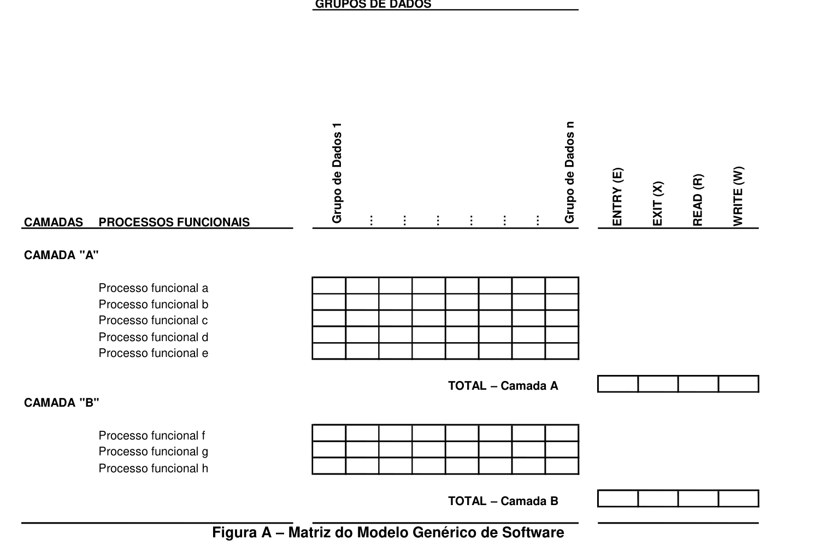

# Apêndice A — Documentando uma Medição de Tamanho COSMIC

> Método COSMIC v3.0.1 — Manual de Medição

A estrutura abaixo pode ser utilizada como repositório para guardar os resultados de uma medição para cada componente identificado de um escopo global que tenha sido mapeado para o Modelo Genérico de Software. Cada escopo dentro do escopo de medição total terá a sua própria matriz.

*Figura A – Matriz do Modelo Genérico de Software*

### FASE DE MAPEAMENTO

- Cada grupo de dados identificado é registrado em uma coluna

- Cada processo funcional é registrado em uma linha específica, agrupado por componente identificado.

### FASE DE MEDIÇÃO

- Para cada processo funcional identificado, as movimentações de dados identificadas são anotadas na célula correspondente, utilizando-se a seguinte convenção: “E” para Entry, “X” para Exit, “R” para Read e “W” para Write.

- Para cada processo funcional identificado, as movimentações de dados são então somadas por tipo e cada total é registrado na coluna apropriada do lado direito, ao final da matriz.

- O resumo da medição pode ser então calculado e registrado nas células/caixas correspondentes a cada componente, na linha “TOTAL”.
